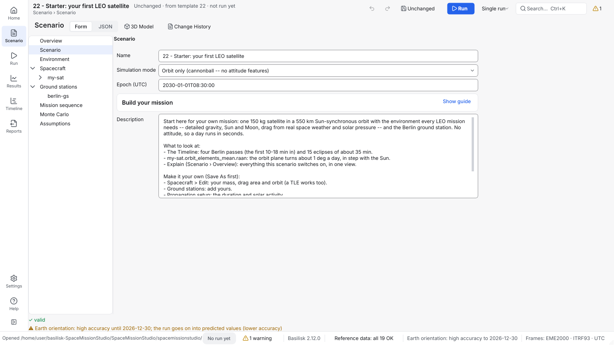

# SpaceMissionStudio

[](https://github.com/0h3xn4/basilisk_space-mission-studio/actions/workflows/spacemissionstudio.yml)


A desktop app for planning and simulating satellite missions, built on
the Basilisk astrodynamics framework.



## What it is

SpaceMissionStudio lets you design a satellite mission in forms, run it,
and read the results, without writing code. Every number comes from
[Basilisk](https://avslab.github.io/basilisk/) (AVS Lab, University of
Colorado Boulder); SpaceMissionStudio adds the windows, scenario files,
plots, checks and analysis around it. Each feature maps to a Basilisk
module, or is marked as the tool's own code.

Start from one of 32 template missions (a single orbit, a GEO slot, a
formation, a complete small satellite with power and a radio link), or
build your own, then look at orbits, ground passes, eclipses, pointing,
battery, link margin, lifetime and propellant.

> **AI authorship.** SpaceMissionStudio was written by Claude
> (Anthropic's AI model) through Claude Code: the application code, the
> tests, this documentation, [`HISTORY.md`](HISTORY.md) and the commits.
> A person reviewed the work, decided what to build next and approved
> what was merged, but did not write the code or the text. Anyone
> evaluating the project should know this from the start.

## Quick start

On Linux (Windows: see [Getting started](docs/getting-started.md)):

```bash
git clone https://github.com/0h3xn4/basilisk_space-mission-studio.git
cd basilisk_space-mission-studio/SpaceMissionStudio
python3 -m venv .venv
source .venv/bin/activate
pip install "bsk[all]==2.12.0"
pip install -e ".[gui]"
spacemissionstudio kernels-status
spacemissionstudio earth-orientation --fetch
spacemissionstudio gui
```

The app opens on **Home**. Click the card **22 - Starter: your first LEO
satellite**, **Open template**, then **Run** (`Ctrl+R`).
A few seconds later the **Results** area shows the orbit and the
**Timeline** lists four ground passes over Berlin.

## Where to go next

| You want to | Read |
|---|---|
| Install it, step by step, on any system | [Getting started](docs/getting-started.md) |
| Do a specific task ("How do I…?") | [How-to guides](docs/user-manual/README.md) |
| Learn the app from the beginning | [User Manual](USER_MANUAL.md), also in the app (**Help**, the last button of the navigation rail, `F1`) |
| Learn by example | The [template catalog](spacemissionstudio/scenarios/templates/README.md) and the [Python examples](examples/README.md) |
| Fix a problem | [Troubleshooting](docs/troubleshooting.md) and the [FAQ](docs/faq.md) |
| Look up a term | [Glossary](docs/glossary.md) |
| See everything | [Documentation index](docs/README.md) |
| Contribute | [Contributing](CONTRIBUTING.md) and the [developer guide](docs/developer/README.md) |

## Features

- **Scenarios** as plain JSON: spacecraft, orbits (elements, position
  and velocity, or a TLE), gravity, ground stations, space weather, a
  Mission Sequence and Monte Carlo dispersions; checked as you type, in
  forms or as text in a code editor (colours, problems marked in place,
  completion and help, rename, quick fixes).
- **Orbits:** detailed Earth gravity, Sun and Moon, drag from real space
  weather, solar pressure, measured Earth orientation (ITRF93), runs of up
  to about 10 years.
- **Pointing:** five pointing modes, star trackers, IMUs, sun sensors,
  magnetometers, reaction wheels, thrusters, torque rods, momentum
  unloading, navigation error, surface facets and flexible solar arrays.
- **Orbit keeping:** LEO station keeping, GEO longitude and inclination
  boxes, formations with three control laws, Walker constellations
  that can hold their spacing.
- **Mission Sequence:** coast, burn, Lambert transfers, reports,
  conditions and loops, stopping on events such as a ground pass.
- **Analysis:** ground passes, eclipses, power, radio link margin,
  onboard data and downlink, thermal, Monte Carlo, orbital lifetime and
  deorbit, ESA AD10-style propellant budgets with launch-delay and
  altitude trades.
- **Results:** interactive plots, an events timeline, a time cursor
  shared by every view, run comparison, CSV, PNG and SVG export, and a
  provenance record on every output.
- **Transparency:** **Show calculation** beside a figure opens its
  equation, inputs and rule; named parameters a project file can change;
  a change history beside each scenario; plugins with models and rules
  of your own; reproduction bundles that run again on another computer.
- **3D model** of the spacecraft, built from shapes, `.obj` meshes or an
  IDM-CIC model: its mass, center of mass, inertia, surfaces, equipment
  and stowed configuration (from IDM-CIC also its sensors and actuators,
  its thrusters from their plume cones, the power budget's bus load and solar panel, and the values your team
  keeps as properties); design checks (fields of view, thrusters, mass
  budget, launcher fit) and analyses after a run (disturbance torques,
  blinding, shading, exposure, brightness, a preliminary re-entry
  estimate).
- **Exchange:** CCSDS OPM, OMM and OEM orbit messages, in the app and on
  the command line; IDM-CIC models (read only); flight-software export
  as a standalone C project; software-in-the-loop testing of your own
  flight software.
- **3D view** of a run inside the app (**Results › 3D View**), after the
  run or live while it runs.
- **Command line** for every analysis, and a Python API.
- **Offline by design:** nothing is downloaded without asking.

Details, and the Basilisk module behind each feature:
[Capabilities and verification](docs/reference/capabilities.md).

## Requirements

| | |
|---|---|
| System | Linux x86_64 or aarch64 (glibc 2.34 or newer), Windows 10 or 11 x86_64 |
| Python | None for the installers (they bring Python 3.14); 3.14 from source (older versions are not supported). CI tests 3.14 |
| Basilisk | 2.12.0: in the installers, or from PyPI (`bsk`) |
| Disk | About 1.7 GB, including the reference data |
| Internet | None for the installers; once from source, to install and fetch the reference data |

The Linux `.deb`, the Windows setup program and the install scripts are
in [`packaging/`](packaging/README.md). From 1.1.1 the two installers
are self-contained: their own Python, Basilisk and reference data, no
internet needed.

## Licence and status

- **Licence:** SpaceMissionStudio is licensed under the European Union
  Public Licence v. 1.2 (EUPL-1.2) from the release after 2.6.0
  ([`LICENSE`](LICENSE); German text [`LICENSE.de`](LICENSE.de)).
  Releases 1.0.0 to 2.6.0 were published under the ISC licence and stay
  under it. The EUPL covers SpaceMissionStudio's own work in
  `SpaceMissionStudio/` only: Basilisk, which it uses, remains under its
  ISC licence and its own copyright holders. Everything the packages
  bundle is listed with its licence in [`THIRD_PARTY_NOTICES`](THIRD_PARTY_NOTICES).
  No copyright is claimed in SpaceMissionStudio's own code, which an AI
  model wrote (see AI authorship above); 0h3xn4 publishes it under the
  EUPL-1.2 as its licensor.
- **Independence and warranty:** SpaceMissionStudio is an independent
  personal project. It is not affiliated with or endorsed by the
  organisations named in its documentation, such as NASA, ESA, the AVS
  Lab of the University of Colorado Boulder, CNES or The Qt Company.
  SpaceMissionStudio is free of charge and comes without warranty; see
  Articles 7 and 8 of the EUPL-1.2. Check its results independently
  before you use them for a real mission.
- **Version:** 2.7.0 ([release](https://github.com/0h3xn4/basilisk_space-mission-studio/releases/tag/spacemissionstudio-v2.7.0),
  [changelog](CHANGELOG.md)): **Results › 3D View** is a real 3D
  renderer (the textured Earth lit by the Sun, the stars, the Moon, each
  spacecraft's model with its fields of view and plumes, the ground
  stations, several camera views) and can show a run live while it
  computes, paced to real time if you like; the app starts on Home with
  nothing open; the external viewer support is removed; and the licence
  is the EUPL-1.2. 2.6.0 played a run back in 3D inside the app, enforced
  and logged network use, with an audit you can run, and made the
  installers hash-checked with a bill of materials. 2.5.0
  made the JSON page a code editor and put IDM-CIC thrusters on the 3D
  model from their plume cones; 2.4.0 read each device's axis from its shapes and can put the
  body frame's origin at the centre of gravity; 2.3.0 brought the satellite's sensors, actuators,
  power budget and team properties in, and a Walker constellation that
  holds its spacing; 2.2.0 put CCSDS orbit files (OPM,
  OMM, OEM) in the app; 2.1.1 fixed 2.1.0, which was the
  spacecraft as designed. Its 3D model
  carries the equipment, a stowed configuration and materials, and the
  tool checks fields of view, thrusters, the mass budget and launcher fit
  and analyses disturbances, blinding, shading, exposure, brightness and
  re-entry with it; the model can be imported from IDM-CIC (© CNES) and
  updated from its later versions. Before it: 2.0.0, a glass box (every
  figure opens its calculation, every rule is a parameter, every result
  can be reproduced, a Python API; Python 3.14 from source, and 1.x
  cannot open the files it saves); 1.3.1 made the window faster; 1.3.0 brought
  a new interface (a navigation rail, the command palette, units in the
  fields, a Timeline for long runs, every export in Reports) with what
  the tool computes unchanged ([before and after](docs/ui/BEFORE_AFTER.md));
  1.2.0 guided a mission from scratch to a first run; 1.1.1 made the
  installers for Linux and Windows self-contained; 1.1.0 added
  relative-orbital-element formations, optical and landmark navigation,
  asteroid Eros, Mars's gravity field and albedo on the sun sensors; and
  1.0.0 was the first release of the renewed tool.
- **Platforms:** 2.7.0 has the Linux `.deb`, the Windows setup program
  and the wheel. Both installers carry their own Python, Basilisk and
  reference data; each was installed and run offline by the release
  workflow, the `.deb` also by hand in a container
  ([`packaging/README.md`](packaging/README.md)). The test suite
  also passes in CI on Windows (failures seen there before are fixed or
  under watch, SRelD K-14). macOS is not supported.
- **Known gaps:** [Known limitations](docs/reference/limitations.md).
- **Standards:** the project's ECSS and CCSDS records are in
  [`compliance/`](compliance/README.md). They are the project's own
  records, not a certification.

## Related tools

| Tool | Relation |
|---|---|
| [Basilisk](https://github.com/AVSLab/basilisk) | The simulation engine; this repository is a fork of it |
| [GMAT](https://sourceforge.net/projects/gmat/) | NASA's mission analysis tool; used as a reference to validate the app (time scales, propagation, CCSDS files) |

SpaceMissionStudio has no direct integration with other mission tools;
it exchanges data through the files listed in [Tips](docs/tips.md).

---

**Next:** [Getting started](docs/getting-started.md) ·
[Documentation index](docs/README.md)
