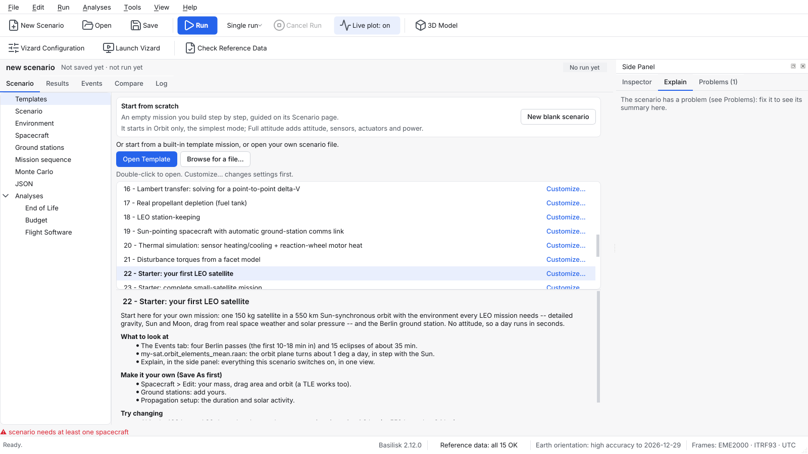
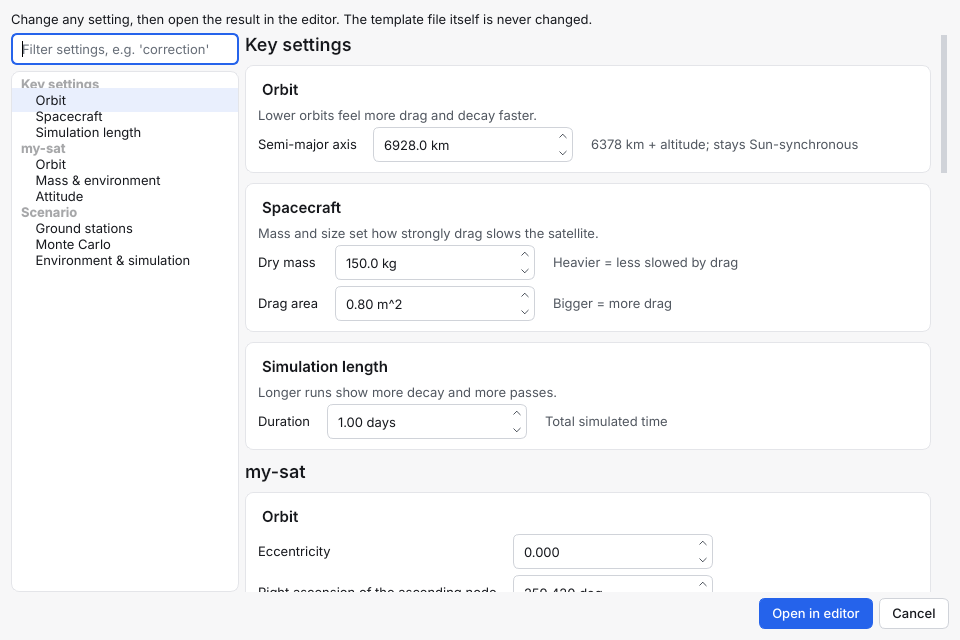
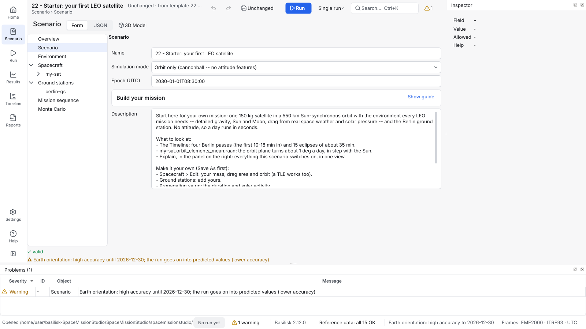
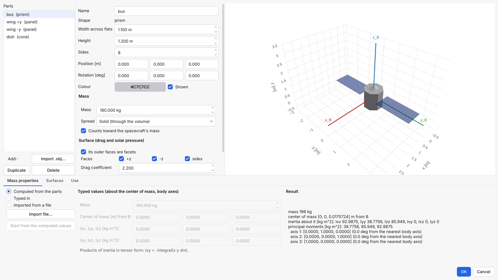
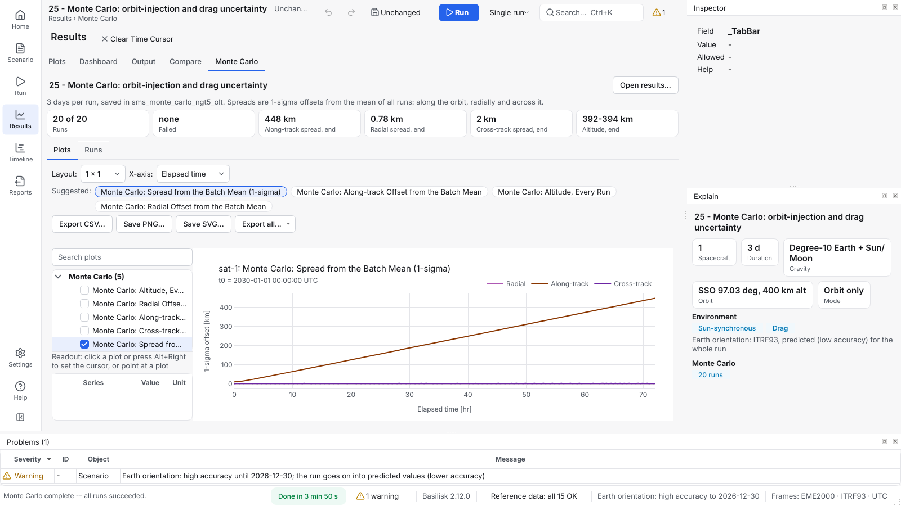

# SpaceMissionStudio User Manual

A beginner-friendly, step-by-step guide to using the SpaceMissionStudio app --
no programming and no prior spacecraft-engineering background assumed.
Every screenshot and command name below is taken directly from the real
application.

**Looking for something else?**

* Installing SpaceMissionStudio: [Getting started](docs/getting-started.md),
  step by step for Linux and Windows.
* Short task-by-task pages ("How do I…?"): [How-to guides](docs/user-manual/README.md).
* Every document in one place: [Documentation index](docs/README.md).
* Using it from Python scripts: [`examples/`](examples/README.md).
* The full technical capability list and verification status:
  [Capabilities and verification](docs/reference/capabilities.md).
* The story of how a specific feature or bug came to be: [`HISTORY.md`](HISTORY.md).

This manual only covers *using the app once it's installed*.

## Contents

1. [What is SpaceMissionStudio?](#1-what-is-spacemissionstudio)
2. [Installing it](#2-installing-it)
3. [Starting the app](#3-starting-the-app)
4. [Your first simulation, in five minutes](#4-your-first-simulation-in-five-minutes)
5. [Tweaking a template without the full editor](#5-tweaking-a-template-without-the-full-editor)
6. [A tour of the Scenario Editor](#6-a-tour-of-the-scenario-editor)
7. [Reading the results](#7-reading-the-results)
8. [Saving your work](#8-saving-your-work)
9. [3D visualization with Vizard](#9-3d-visualization-with-vizard)
10. [Monte Carlo: running many variations at once](#10-monte-carlo-running-many-variations-at-once)
11. [Common questions and problems](#11-common-questions-and-problems)
12. [A short glossary](#12-a-short-glossary)
13. [Where to go next](#13-where-to-go-next)

---

## 1. What is SpaceMissionStudio?

SpaceMissionStudio is a desktop application for planning and simulating space
missions -- things like "what orbit should this satellite be in?",
"how much fuel does it take to keep a satellite parked over one spot on
Earth?", or "how does this spacecraft's pointing behave if I swap its
sensors?". You build a **scenario** (one or more spacecraft, their
starting orbits, optional sensors/actuators/ground stations), click
**Run**, and get back real physics: trajectories, fuel use, pointing
accuracy, ground-station visibility, and more.

Under the hood, every number comes from [Basilisk](https://avslab.github.io/basilisk/),
a real astrodynamics simulation framework built by the University of
Colorado Boulder's Autonomous Vehicle Systems (AVS) Lab -- the same kind
of software used for real mission analysis. SpaceMissionStudio is a friendly
graphical front end over it: you never write code or touch Basilisk
directly.

You do **not** need to be an orbital-mechanics expert to get useful
results. The built-in template missions (Section 4) are a safe, guided
way to learn by doing -- pick one, run it, and see what happens before
you ever build a scenario from scratch.

### How the pieces fit together

Everything revolves around one **scenario**: a single `.json` file that
describes the whole mission. **Run** turns that description into results.

```
Scenario (one .json file)
 |- Epoch and simulation mode ... when it starts; orbit only, or orbit + attitude
 |- Propagation setup ........... planet, gravity detail, Sun/Moon, atmosphere, duration
 |- Spacecraft (one or more)
 |   |- Orbit ................... where it starts: orbital elements, position/velocity or a TLE
 |   |- Mass and shape .......... mass, inertia, drag and sunlight areas (or flat plates)
 |   |- Hardware ................ sensors, wheels, torque rods, thrusters, tank, battery, radio
 |   '- Control ................. pointing mode, station keeping, formation keeping
 |- Ground stations ............. where on Earth, lowest usable elevation, receiver
 |- Mission sequence (optional) . coast, burn, report, step by step
 '- Monte Carlo (optional) ...... which values vary between runs, and by how much
          |
          |  Run: Basilisk computes the physics
          v
Results: a plot of every quantity, a timeline of events, mission reports,
         a dashboard, CSV export, a 3D replay in Vizard
```

Where each piece lives in the app, and which template shows it best:

| Piece | Where you edit it | Learn it from template |
|---|---|---|
| Simulation mode, epoch | Scenario tree > **Scenario** | 01 (orbit only), 06 (attitude) |
| Gravity, Sun and Moon, atmosphere, duration | Scenario tree > **Environment** | 02, 18 |
| A spacecraft's orbit and mass | Scenario tree > **Spacecraft** > its name > **Orbit / mass** | 01, 22 |
| Sensors and actuators | ... > **Sensors / actuators** | 07, 12, 13, 14 |
| Where it points | ... > **Attitude control** | 06, 15, 19 |
| Power, thrusters, radio | ... > **Power / propulsion / link budget** | 07, 17, 18, 19 |
| Instruments, memory, downlink | ... > **Power / propulsion / link budget** > Data handling | 26 |
| Ground stations | Scenario tree > **Ground stations** > its name | 19, 22 |
| Mission sequence | Scenario tree > **Mission sequence** | 08, 16, 23 |
| Monte Carlo | Scenario tree > **Monte Carlo** | 09, 25 |
| Results | the Results and Timeline areas, Results > Compare (Section 7) | any |

**Orbit only or full attitude?** *Orbit only* simulates where each
spacecraft goes: fast, and enough for orbits, drag, station keeping,
formations and ground passes. *Full attitude* also simulates which way it
points, so sensors, wheels, torque rods, pointing modes, flat-plate
shapes and power from a Sun-facing panel become available; it needs a
small time step and runs slower. Start with orbit only and switch when
you need pointing.

## 2. Installing it

If someone already installed SpaceMissionStudio for you, skip to
[Section 3](#3-starting-the-app).

**Linux:** double-click the `.deb` file you were given, or the one
from the [releases page](https://github.com/0h3xn4/basilisk-SpaceMissionStudio/releases) (or run
`sudo apt install ./spacemissionstudio_<version>_amd64.deb` in a terminal), then
find **SpaceMissionStudio** in your application menu like any other program.

**Windows 10/11:** run `spacemissionstudio-<version>-setup.exe` and click
through it; it installs for your user only, with no administrator
rights. Then start **SpaceMissionStudio** from the Start Menu.

The installers bring everything with them: their own Python, the
Basilisk simulation engine and its reference data (planet positions,
leap seconds, Earth's and Mars's gravity fields, Earth's magnetic field,
Earth orientation). They need no Python on the computer and no internet,
and the app works offline from the start. (This holds from 1.1.1; the
1.1.0 installers were not like this yet: they downloaded Basilisk and the data while installing,
and the 1.1.0 Windows setup also needed Python 3.11.)

**No installer, or want to run it from source?**
[Getting started](docs/getting-started.md) walks through every way to
install it, with copy-and-paste commands, how to check that it works,
and what to do when it doesn't.

## 3. Starting the app

* **Installed with an installer or the install script:** open
  **SpaceMissionStudio** from your application menu (the Start Menu on
  Windows), same as any other program.
* **Running from source:** open a terminal in the project folder and run
  `spacemissionstudio gui` (or `python3 -m spacemissionstudio.gui.app`).

The window opens on **Home**. Each time the app starts, a card at the
top of Home, **Fetch or update reference data?**, offers to check for
newer reference data (support data, space weather, Earth orientation).
Tick what you want and press **Fetch now**: the download runs while you
carry on, and a note at the bottom right sums it up when it is done.
**Not now** hides the card, and nothing is downloaded (**Settings >
Reference data** downloads later). Home looks like this:



A few things to notice right away:

* The **navigation rail** on the left holds the app's areas, top to
  bottom (`Ctrl+1` to `Ctrl+6`):
  * **Home**: where you start. **Start from scratch** (**New blank
    scenario**), **Open a scenario file...** and your **Recent
    scenarios** on the left; a card per template in the middle; the
    selected template's description on the right.
  * **Scenario**: the scenario tree on the left and the page of the node
    you pick beside it: **Overview** (Explain: what the scenario does, end
    of Section 7), **Scenario**, **Environment**, **Spacecraft** with
    a node per spacecraft, and under each one a node per part of its page
    (**Orbit / mass**, **Sensors / actuators**, **Attitude control**,
    **Power / propulsion / link budget**, **3D model**, **Vizard model**,
    **Budget (AD10)**; orbit-only scenarios have no sensors or attitude
    control), **Ground stations** with a node per station, **Mission
    sequence** and **Monte Carlo** (Section 6). A node with
    problems shows how many after its name: in red when one of them is an
    error, in yellow when they are all warnings. Hover over it to see how
    many of each there are. At the top, **Form · JSON** switches between
    these pages and the scenario as text (Section 6), and **3D Model...**
    opens the 3D model editor for a spacecraft.
  * **Run**: Run and its mode, **Cancel Run**, **Live plot**, the Vizard
    commands, **Open Monte Carlo Results...** and **Check Reference
    Data** at the top; under them **End of Life** and **Budget** (re-entry
    and delta-V estimates, Section 11) and the **Log** (what the app
    logged in this session, filterable by level and text; a failed run
    opens it at its warnings and errors).
  * **Results**, which fills in when you run something (Section 7), with
    the **Plots**, the **Dashboard**, the mission **Output**, a **Monte
    Carlo** view when the scenario has Monte Carlo on (Section 10) and
    **Compare**: your saved runs, of this session and earlier ones, side
    by side (a summary with differences, the inputs that differ, the
    events and overlaid plots).
  * **Timeline**: passes, eclipses, burns and mode changes (Section 7).
  * **Reports**: **Flight Software** (export the attitude flight
    software and run it in the loop, Section 6).
  * **Settings**, at the bottom: **Appearance** (the theme: **System**,
    light or dark as your desktop is, the default; **Light** or **Dark**;
    a new theme applies at once, to every open view), **Reference data**,
    **Layout** (the rail as icons only, the **Inspector** and **Problems** panels, **Reset Layout**),
    **Keyboard** (every shortcut) and **About**.
  * **Help**, at the bottom: this manual (`F1`). The rail's last button
    shows the areas as icons only, or with their names.

  In this manual, a path such as **Run > Budget** is an area of the rail
  and its page.
* **Fields show their unit after the number**: "550.0 km", "97.59°",
  "1.000 m²"; a field with no unit is a plain number (a coefficient, a
  fraction). This manual and the app's messages name a field with its
  unit in brackets, "Dry mass [kg]", as the scenario file does. Typing a
  number replaces the number only; the unit stays. An optional group
  (Station keeping, Power budget, Monte Carlo, ...) shows only its title
  while it is off; tick it to see and set its fields.
* Every command is also in the **command palette**: press `Ctrl+K`, or
  click the search field in the top bar, and type part of its name
  ("save as", "budget", or a spacecraft's name). There is no menu bar.
* The **Inspector** panel on the right (`Ctrl+I`): the field you are in,
  its value, the range it accepts and its help. **Explain**, a live
  summary of what the scenario does, is the scenario tree's **Overview**
  (end of Section 7); its name in the tree says how many things there are
  to check.
* The **Problems** panel at the bottom (`Ctrl+J`): what does not validate,
  and what looks implausible, as a table: **Severity** (an icon and the
  word), **ID** (the field it is about), **Object** (the scenario, the
  propagation setup, a spacecraft or ground station, the mission
  sequence) and **Message**. Errors come first; click a column's heading
  to sort by it, and `Ctrl+C` copies the selected rows. Double-click a row,
  or select it and press `Enter`, to go where it is fixed: the Scenario
  Editor's field, or the spacecraft, ground station or propagation setup
  dialog opened at the field, with the problem named at the top and under
  the field.
* `Ctrl+I` and `Ctrl+J` show and hide their panel, and a panel they show
  takes the keyboard. Drag a panel elsewhere, close it, or put them all
  back with **Settings > Layout > Reset Layout**. The app remembers the
  layout (the panels, the rail, the dividers' positions) for each
  scenario file: open a file again and its layout comes back. A file
  without one keeps the layout on screen.
* A **top bar** above the area names the scenario and says whether it
  has unsaved changes, where it came from ("from template 22", or the
  file's name) and when it last ran, how it ended and how long it took;
  under that, where you are ("Scenario › Spacecraft › sat-1"). On its
  right: **Undo** and **Redo**, the save button (it says "Saved", "Not
  saved yet" or "Save"; a click saves), **Run** with its mode, the
  search field of the command palette and, while the scenario has any,
  the number of problems (a click opens **Problems**). Runs are numbered in the session
  ("Run 2, 12:19"): the top bar, the plots' provenance line and the
  traces of a comparison name them.
* When a run ends, a note at the bottom right says so: "Run 2 complete
  in 6 s: 4 passes, 15 eclipses". A run that cannot start (a problem in
  the scenario, Monte Carlo turned off, Vizard not connected) or that
  fails says why in a note and the status bar and opens where it is
  dealt with: **Problems** at the field, the Monte Carlo page, or the
  **Log** at its errors. The message stays in the Log. Message boxes are
  kept for questions such as replacing a file.
* The status bar at the bottom shows the run going on: what it is doing
  ("Propagating: day 0.4 of 1"), a progress bar, the time so far and an
  estimate of the time left, and **Cancel** (`Esc`). When no run is going,
  a tag there says how the last one went: **No run yet**, **Run 2: done
  in 6 s**, **Failed** or **Run 2: cancelled**. It always shows the problems ("1 error · 2 warnings", or
  "No problems"; click it to open **Problems**), the Basilisk
  version ("(not qualified)" when it is not the verified 2.12.0), the
  reference data ("all OK", or how many files need attention; click it
  to open the **Reference data** dialog), how far the Earth orientation data is high
  accuracy, and the frames runs use (EME2000 for orbits and results,
  ITRF93 or IAU_EARTH for ground stations, UTC for dates).

The app opens on **Home** deliberately: picking a
starting point is the natural first move for everyone, whether you end
up using a template as-is or editing it into something new. Its first
choice, **Start from scratch** (**New blank scenario**), does what
**New Scenario** (Ctrl+N) does: an empty mission, with a guide to it on
its Scenario page ("Building your own scenario, step by step", below).

* **Recent scenarios** lists the last 10 scenario files you opened or
  saved, newest first (the templates are not listed: they have their
  cards). `Enter` or a double-click opens one; hover over it for its
  folder. A file that was moved or deleted says **(missing)** with a
  warning icon; `Delete` takes the selected entry off the list (the file
  stays where it is) and **Clear** empties it.
* Each **template card** says, all read from the template file itself:
  the attitude mode (**Orbit only** or **Full attitude**, with its
  pointing mode) and how many spacecraft; the central body and the
  orbit (its altitude, or the altitudes of its lowest and highest points
  when it is not circular, the inclination, and "Sun-synchronous" when
  it is); and the first sentence of the template's description. The
  **Filter templates** box narrows the cards to those with every word
  you type ("monte carlo", "formation", "mars").
* Click a card to select it: its whole description appears on the
  right, with **Open template** and **Customize...**. The keyboard
  reaches the cards with `Tab`; the arrow keys move between them and
  `Enter` opens one. A card's own **Open** and **Customize...** act on
  that card, whatever is selected.

## 4. Your first simulation, in five minutes

1. **Pick a template.** Home shows all 31 built-in example missions as
   cards, numbered roughly from simplest to most advanced -- "01 -
   Two-body circular orbit" is the simplest possible case (one
   satellite, one orbit, nothing else going on) and a good first choice.
   Click its card once; its description appears on the right,
   explaining what it demonstrates and what to look for.
2. Click **Open template** (or the card's **Open**, or double-click the
   card). The
   app shows the mission's **Scenario** page -- you don't need to look at
   or understand it yet, just confirm something loaded (its name appears
   in the "Name" field at the top).
3. Click **Run** in the top bar (or press `Ctrl+R`).
   The mode beside it says what Run starts: **Single run** here. While it
   runs, a strip under the top bar shows what it is doing ("Propagating:
   day 0.40 of 1"), how far it is, the time so far and, once it can tell,
   about how long is left; **Cancel** (`Esc`) stops it. A short run like
   this one finishes in seconds.
4. When it finishes, the app switches to the **Results** area
   automatically. Click a plot in the catalog on the left (e.g. a
   spacecraft's position) to see it, or tick several to see them side by
   side. Hover over a plot to read exact values at any point.
5. Done exploring? **Export CSV...** saves every plotted
   quantity to a folder of `.csv` files you can open in a spreadsheet.

That's the whole loop: **pick -> open -> run -> look at Results.**
Every other feature in the app builds on top of this one. Try a few
more templates before moving on -- the cards' descriptions (and
[`spacemissionstudio/scenarios/templates/README.md`](spacemissionstudio/scenarios/templates/README.md))
tell you what each one teaches, from simple circular orbits up through
constellations, formation flying, attitude control, and propellant
tracking.

**Nothing happened when you clicked Run?** See
[Section 11](#11-common-questions-and-problems) -- the most common
cause is that Basilisk, the simulation engine itself, isn't installed
yet; the app will say so clearly rather than failing silently.

### Which template next?

Each template shows one idea, so a few at a time is plenty. A suggested
path, each step building on the one before:

| Step | Templates | What you learn |
|---|---|---|
| 1. Orbits | 01, 02, 22 | An ideal orbit; what Earth's shape, the Sun and the Moon do to it; a realistic satellite with drag and a ground station |
| 2. Keeping an orbit | 18, 03, 17 | Station keeping against drag (low orbit) and drift (geostationary); how propellant runs down |
| 3. Pointing | 06, 07, 15, 14, 27 | Attitude control, ideal and with real hardware; pointing at the Moon; finding the Sun with sun sensors; flexible wings swinging in a turn |
| 4. Disturbances and momentum | 10, 21, 12, 13, 11 | Gravity-gradient and surface torques; unloading wheels with thrusters or torque rods; thrusters for pointing |
| 5. Missions in steps | 08, 16, 23 | Mission Sequences: burns, a Lambert transfer, stopping on a ground pass |
| 6. Several spacecraft | 04, 05, 24, 29 | A Walker constellation; a formation held by two different control laws; a passively safe formation in relative orbital elements |
| 7. Whole systems | 19, 20, 23, 26 | Power, radio link and thermal working together; data from instrument to ground |
| 8. Uncertainty | 09, 25 | Monte Carlo batches: mass, orbit insertion, drag |
| 9. Navigation | 30, 31 | Estimating an orbit around Mars from camera images of the planet; flying around asteroid Eros with its shape's gravity and navigating from its landmarks |

**Starting your own mission?** Open **22** (a realistic satellite, orbit
only) or **23** (a complete small satellite with hardware, a radio link
and a Mission Sequence), use **Save As...** (Ctrl+Shift+S), and change it step
by step (Section 6).

## 5. Tweaking a template without the full editor

Say "22 - Starter: your first LEO satellite" is close to what you
want, but you'd like a lower orbit or a heavier satellite, without
learning the full Scenario Editor. Every template card on Home has
its own **Customize...** button -- click the one on that template's
card (no need to select the card first; the description on the right
has **Customize...** too, for the selected card):



It opens one window with every setting of that template, pre-filled
with its current values: the handful that matter most under **Key
settings** at the top, then everything else grouped by spacecraft and
topic. The list on the left jumps to a section; the filter box finds a
setting by name ("drag", "duration"). Change what you like, then
**Open in editor**: the result opens in the Scenario Editor, ready to
run. The original template file on disk is never modified, whether you
use this dialog or the full editor -- so you can always come back to a
clean copy later.

## 6. A tour of the Scenario Editor

You don't need to understand every field here to use SpaceMissionStudio --
most people start from a template (Section 4) or its customize wizard
(Section 5) and never touch most of this. This section is for when you
want to build something more specific, or just want to know what you're
looking at.



The scenario is a tree on the left of the **Scenario** tab, in roughly
the order you'd fill it out for a brand-new scenario. Pick a node to edit
its page; what you change there applies as you type (Undo, Ctrl+Z, takes
it back), and a page whose values do not validate marks the field, lists
it in **Problems**, and keeps the scenario from running until it is
fixed:

* **Scenario** -- the mission's name, its **Simulation mode**
  ("Full attitude" if you need sensors/actuators/pointing control, or
  the simpler "Orbit only" if you just care about trajectories; a blank
  scenario starts in Orbit only), the **Epoch** (the real calendar
  date/time the simulation starts, in UTC), the **Build your mission**
  guide (the steps to a first run, and what else the tool does) and a
  free-text **Description**.
* **Environment** -- which planet you're orbiting, how detailed its
  gravity model is (spherical harmonics for Earth, to degree 180, and
  Mars, to degree 80), which other bodies' gravity to include (Sun, Moon,
  ...), the numerical integrator, how long to simulate, and atmospheric
  drag/space-weather settings.
* **Spacecraft** -- the list of spacecraft in the mission, and under it a
  node for each one. A spacecraft's page has its own tabs: **Orbit /
  mass**, **Sensors / actuators**, **Attitude control**, **Power /
  propulsion / link budget**, **3D model**, a cosmetic **Vizard model**
  tab (Section 9) and **Budget (AD10)** (Section 11). In the list,
  **Edit** (or a double-click) goes to the spacecraft's node, and
  **Add** adds one with the default values and opens its node, ready to
  set up (Remove or Undo take it back). **New from template...** adds a complete
  spacecraft from a 100-500 kg preset instead of a blank one, and opens
  its node too. On **Sensors / actuators**, pick a device in a list to
  edit it in the form under the list; **Add** adds one of the first kind
  with its template's values, and changing its **Kind** shows that kind's
  parameters. An edit applies as you type, once it is valid; one that is
  not (a name already taken) is not applied, and the form says why. An orbit can be specified as classical orbital
  elements (semi-major axis, eccentricity, inclination, ...), Cartesian
  position/velocity, or a TLE (the format real tracked satellites are
  published in) -- pick whichever you have on hand. Switching between
  them asks first: **Convert and switch** keeps the same orbit (it shows
  the values before and after, converted by Basilisk's own `orbitalMotion`
  at the scenario epoch), or **Use the ... page's values** takes what that
  page already holds. A TLE is never made from the other forms: it holds
  SGP4 mean elements fitted to tracking data. There are also
  **Generate Walker constellation...** and **Generate phasing
  formation...** buttons here for building multi-satellite setups
  automatically instead of adding spacecraft one at a time.
  On the orbit & mass tab, **Surface facets** describes the spacecraft as
  flat plates (**Box + solar array...** fills in a bus and an array).
  Drag and solar pressure then follow the attitude, and an off-centre
  plate adds a torque the wheels must absorb (template 21).
* **Ground stations** -- optional stations on the ground to check
  visibility/communication with (each spacecraft's contact windows,
  signal link margin, etc.), each a node with its own page. **Add** adds
  one and opens its page.
* **Mission sequence** -- an optional, ordered list of commands (coast
  for a while, do a burn, take a snapshot, ...) for missions more
  complex than "just propagate forward for N days". Each step reads as a
  sentence ("Propagate until sat-1's next pass over berlin-gs starts"),
  with its kind's icon. Pick a step to edit it in the form beside (or,
  on a narrow window, under) the list; it applies as you type. **Add
  step** adds one after the selected step, **Add inside** one inside an
  `if` or `while`; drag a step to move it (into an `if`/`while` too), or
  use **Move up**/**Move down** (Alt+Up, Alt+Down). Untick a step to
  leave it out of the run, as if it were not there; it is still checked
  for problems, and a sequence with every step unticked runs for the
  set duration like a scenario without one. A step with a problem is
  shown in red, the problem over its form. A propagate can stop
  after a duration, at an epoch, or at an event: periapsis, apoapsis, or
  the start or end of the next pass over a ground station
  (`pass_start`/`pass_end`). A `pass_start` issued during a pass waits
  for the next one. Explain (**Overview**) lists each station's first pass and
  how long it lasts. A `maneuver` or `lambert_transfer` burn is an
  instant change of velocity only: it uses no propellant and leaves the
  mass unchanged. For propellant, use the **Budget** page (Section 11)
  or a fuel tank with station-keeping or constant thrust.
* **Monte Carlo** -- see Section 10.

**Form · JSON**, at the top of the area, shows the scenario as it is
saved, as text you can edit, in place of the tree. An edit there applies
to the pages half a second after you stop typing, checked as when a file
is opened; an edit on a page shows there. Text that is not JSON (a
missing comma) is not applied: its line is marked, the banner says where
and what is wrong (its count shows on **JSON**), and the scenario cannot
run or be saved until it is fixed, discarded or another scenario is
opened. Going back to **Form** applies an edit still waiting, and is
refused while the text is not valid: fix it, or press **Discard** to put
the scenario's own text back.

A **validation message** at the very bottom of this tab updates live as
you type, in plain language (e.g. naming exactly which field is missing
or invalid) -- you don't have to guess why Run is unavailable. It names
the first problem and how many more there are; **Problems** lists them
all. A message names a field as its form does, after its section ("my-sat:
Station keeping: Reboost thrust [N] must be > 0"); the command line and the
Log give the same message with the field's name in the scenario file
(`station_keeping.thrust_n`).

A value in a file outside the range a field takes (a station 12 000 m
up, where the field goes to 9000 m) is kept, not cut to the range: the
field shows the nearest value it takes, is marked, and Problems says
which value the scenario keeps. Changing the field replaces it. The
spacecraft's fields are checked when its page is first opened.

### Building your own scenario, step by step

The quickest way to a mission of your own is a starter template (22 or
23) and **Save As**. To start from an empty scenario instead:

1. **New Scenario** (Ctrl+N), or **New blank scenario** on **Home**. The Scenario page opens with **Build your mission**: the steps
   below, each with its state (*Needed*, *Optional*, *Done*, *Ready*) and
   a button to its page, and **There is more**: what else the tool does
   (Full attitude, the mission sequence, constellations and formations,
   Monte Carlo, the analyses, other central bodies, the templates), each
   with a button to where it is set. Give the scenario a **Name** and set
   the **Epoch (UTC)**: the date decides where the Sun and Moon are, how
   dense the upper atmosphere is and when ground stations see you. A blank
   scenario starts in **Simulation mode** *Orbit only*, the simplest
   (Section 1 explains the choice); switch to *Full attitude* (or press
   **Switch to Full attitude** in the guide) when the mission needs
   attitude, sensors, actuators or power.
2. **Environment**: for a satellite around Earth, tick
   **Enable spherical-harmonics gravity** with degree 10, add **sun** and
   **moon** as third-body perturbers, start with a **Duration** of 1 day,
   and leave the atmosphere on the bundled, real space-weather data.
3. **Spacecraft**: **Add**, or **New from template...** for a 100-500 kg
   preset (in *Orbit only* mode it keeps the preset's mass, inertia and
   drag areas and leaves its hardware out); the spacecraft then has its
   own node in the tree. On its **Orbit / mass** tab: the semi-major axis is Earth's
   radius (6378 km) plus the altitude, so 6928 km for 550 km. For an
   Earth-observation orbit, press **Compute Sun-sync inclination for
   this altitude** and **Compute RAAN for LTAN...** (10:30 is the usual
   local time). Have a real satellite's TLE? Choose the TLE orbit type
   and paste it. Then set the **Dry mass**, and tick **Enable atmospheric
   drag** with its area (and **Enable solar radiation pressure**).
4. **Ground stations**: **Add**, then its name, latitude, longitude and the
   lowest usable elevation (10 deg is common).
5. Look at the bottom of the page: **✓ valid** means Run is available;
   otherwise the message names the field to fix, the field is marked in
   red with the message under it, and its node in the tree shows a count
   (the **Problems** panel lists it too; double-click it to go
   to the field). **Overview** (Explain), first in the tree,
   already shows the orbit type, the ground passes and what the
   environment includes, before anything runs.
6. **Save As...** (Ctrl+Shift+S), then **Run** (`Ctrl+R`).
7. Grow it one step at a time, running after each: switch to *Full
   attitude* and pick a pointing mode on **Attitude control**; add
   sensors and actuators; add station keeping on **Power / propulsion /
   link budget**; add a Mission Sequence. When a result changes, you know
   which step changed it. Template 23 is this process, finished.

### Formation control laws

A follower's **Phasing keeping** (the spacecraft's page, power/propulsion
tab) holds its distance ahead of the chief with one of three laws, set
in **Control law**. All three use the follower's station-keeping
thruster and tank, and none fires in eclipse.

| Law | How it works | Good for |
|---|---|---|
| Drift orbit (default) | When the separation leaves its tolerance, a burn lowers or raises the orbit slightly, the follower drifts back, and a second burn stops it. | Long missions; the fewest firings. |
| Mean orbital elements | Basilisk's `meanOEFeedback`: continuous feedback on all six mean orbital elements. | Holding a separation to tens of metres, at a much higher delta-V. Earth with J2 (gravity degree 2 or more) only. |
| Hill-frame PD | Basilisk's `hillFrameRelativeControl`: holds a fixed point next to the chief. | Close formations, about a kilometre, for short phases. |

Measured on template 05 (550 km, 405 kg, 0.05 N thruster; 90 days with
degree-10 gravity, Sun, Moon and drag):

* Drift orbit kept the follower within 5 km of 50 km (2.3 km RMS) for
  0.014 m/s.
* Mean orbital elements kept it within 65 m (26 m RMS) for 3.3 m/s, about
  230 times as much. Started 5 km off, it closes the gap within a day for
  2.6 m/s.
* Hill-frame PD holds 1 km for about 0.9 m/s a day. It fights every
  natural relative motion, J2's included.
* Hill-frame PD cannot hold template 05's 50 km. Its straight-line
  feedforward needs 6.5e-4 m/s^2 there, five times what the thruster
  gives. When it asks for more than the thruster can give, it diverges;
  Explain (**Overview**) warns before you run.

Neither Basilisk law was designed for a thrust limit. Their requests are
cut to the thruster's thrust, and requests under half a minimum impulse
bit are not fired. The Basilisk gains are in the same group. The drift
orbit's tolerances apply to the drift orbit only. With a Basilisk law,
the follower's own station keeping never fires: the law follows the
chief's reboosts itself.

### Formations in relative orbital elements

An **ROE formation (relative orbital elements)** (the follower's page,
power/propulsion tab) holds a follower in a formation around a chief,
given as six numbers in metres: the chief's semi-major axis times each
quasi-nonsingular relative orbital element (D'Amico).

* **a·δa**, the relative semi-major axis: the follower drifts along-track
  while it is not zero.
* **a·δλ**, the relative mean longitude: where along the track the
  follower's centre of motion sits, + ahead.
* **a·δex, a·δey**, the eccentricity vector: an ellipse around that
  centre, this half-size radially and twice it along-track.
* **a·δix, a·δiy**, the inclination vector: the cross-track motion.

With the two vectors parallel the orbits never cross in the
radial/cross-track plane, so a lost along-track spacing cannot bring the
two together: the formation is *passively safe*. The app shows the
closest radial/cross-track approach under the targets table, in the
generator and in Explain (**Overview**), which also draws the vectors.

**Targets** is a schedule: each row holds from its start day to the
next, so a follower can approach and then move to a helix. **Generate ROE
formation...** under the Spacecraft list adds a follower already placed
on its formation (Basilisk's mean-to-osculating J2 mapping), from a
passively safe shape or from the six numbers.

Two control laws fire the follower's station-keeping thruster (its station
keeping itself then never fires), never in eclipse:

| Law | How it works |
|---|---|
| Impulsive burns (planned with the J2 model), default | When the mean ROE leave their tolerances: along-track burns for a·δa and the eccentricity vector, a cross-track burn for the inclination vector, and a drift for the along-track offset. Planned with the J2 state transition matrix (Koenig, Guffanti and D'Amico 2017), fired only in sunlight. |
| Continuous (Basilisk meanOEFeedback) | Basilisk's mean-element feedback, aimed at the elements the target gives. A tighter hold for more delta-V. |

Measured on template 29 (two 150 kg satellites at 550 km, 0.05 N
thrusters, from 2 km behind to a 300 m helix on day 1): the impulsive law
is on target 1.5 days after the switch for 0.56 m/s, then holds within
13 m along-track for 0.026 m/s in 1.5 days; the continuous law is on
target in 0.4 days and within 3 m from day 2, for 1.85 m/s in 4 days.

The chief must be near-circular (eccentricity up to 0.01) and inclined,
around Earth with J2; one run is at most 100 days; a follower cannot
also have phasing keeping.

**Differential drag.** When the two spacecraft feel different drag, the
impulsive law measures how fast their relative semi-major axis decays
(**Compensate differential drag**, on by default) and sets it so the
along-track offset swings evenly about its target between corrections.
With three times the chief's drag area on template 05's follower, a
3-day hold stays within 13 m along-track for 30 burns and 0.036 m/s,
against 27 m, 60 burns and 0.044 m/s without it. See
[Fly a formation with relative orbital elements](docs/user-manual/roe-formation.md).

### Optical navigation

**Optical navigation (camera on the central body)** (the spacecraft's
page, power/propulsion tab) gives a spacecraft a camera that sees the
central body's disk. Each image is reduced to where the disk's centre is
and how large it is, computed from the true geometry with pixel noise (no
image is rendered). Basilisk's `pixelLineConverter` turns that into a
position relative to the body (the range from the disk's size), and
Basilisk's `relativeODuKF`, a Kalman filter with two-body dynamics,
estimates position and velocity.

The central body must be Earth, the Mars barycentre or the Jupiter
barycentre, with the Sun in the run: images from beyond the **Largest
phase angle** (90 deg by default, the night side) are not used. In an
orbit-only run the camera points at the body perfectly; with attitude,
point it with **locationPointing** on the central body along the
camera's boresight. Results are under `{spacecraft}.optical_navigation.`:
the filter's error and 3-sigma bounds, one image's error, the disk on the
detector and whether each image was used.

Measured on template 30 (an 18 000 km x 0.2 orbit around Mars, a 40 deg
512 px camera, 0.5 px noise): one image alone is good to 56 km (median);
the filter, started 68 km off, is within 2 km by day 1 and 1.6 km
(median) after it, up to 12 km just after each night-side stretch. See
[Navigate from camera images of a planet](docs/user-manual/optical-navigation.md).

### Small bodies and landmark navigation

**433 Eros** can be the central body (Scenario Editor, gravity). It needs
two files from **Reference data** (**Download...**, **Small bodies**): its
ephemeris, a JPL Horizons solution from NAIF (1900 to 2100), and Gaskell's
NEAR shape model. **Gravity from the shape model** gives its gravity from
the shape at constant density (Basilisk's `polyhedralGravityModel`)
instead of a point mass; close to an elongated body the difference is
tens of percent. Eros turns once every 5.27 h; results include the
position in its frame (`{spacecraft}.position_P`), and a position inside
the shape is reported as an impact. Runs around Eros are one simulation
of at most 100 days.

**Landmark navigation** (the spacecraft's page, power/propulsion tab)
places landmarks on the shape. Basilisk's `pinholeCamera` reports the
whole pixel of each one it sees (lit, facing the camera, on the
detector), and the app's own Kalman filter estimates position and
velocity from them, predicting with the shape's gravity. It needs the
shape's gravity and the Sun in the run. Results are under
`{spacecraft}.landmark_navigation.`.

Measured on template 31 (a 35 km orbit over Eros's poles, 100 landmarks,
a 30 deg 1024 px camera): the filter, started 100 m off, is within 0.35 m
(median) after the first image, up to 4.8 m just after the night-side
stretches. See
[Fly around an asteroid and navigate from its landmarks](docs/user-manual/small-body-navigation.md).

### Data handling and the downlink

**Data handling** (the spacecraft's page, **Power / propulsion / link budget**
tab) gives a spacecraft instruments, an onboard memory and a transmitter,
all Basilisk modules (`simpleInstrument`, `partitionedStorageUnit`,
`spaceToGroundTransmitter`):

* Each instrument writes at a constant rate into its own part of the
  memory. For an instrument that does not run all the time, give its
  orbit-average rate. Housekeeping telemetry is an instrument too.
* A full memory takes nothing more: what does not fit is lost, and the
  run counts it.
* With the **Downlink RF link budget** on, the transmitter sends at the
  link's data rate to any ground station whose link closes: the station is
  in view and the Eb/N0 margin is 0 dB or more. It empties the fullest
  part of the memory first.
* Instruments and the transmitter can draw power from the power budget.

**Antenna pattern** (same group as the link budget) says how the
antenna's gain falls off away from its boresight. The margin then uses
the gain toward the station at every step, from the simulated attitude:

| Pattern | Gain toward the station | Use it for |
|---|---|---|
| Fixed gain | The TX antenna gain, always | An antenna that tracks the station (comms pointing), or a first estimate |
| Patch (cos^n) | The peak gain times cos^n of the angle off boresight, n from the peak gain; behind the ground plane, the front-to-back ratio below the peak | A patch antenna on a body face, before you have its datasheet |
| Gain table | The datasheet's gain against angle, interpolated in dB | A real antenna |

The cos^n model takes the gain as the directivity. A real patch's gain
is below its directivity, so for the same gain its beam is narrower than
the model's (120 deg wide at half power for 6 dBi): a datasheet table is
closer. Basilisk's own antenna model (`simpleAntenna`) is not used: it
needs a directivity above 9 dB, which a patch does not have.

The run records, per spacecraft, `<sc>.data_handling.stored` (in total and
per instrument), `.downlink_rate`, `.data_generated`, `.data_downlinked`
and `.data_lost`; and per station `<gs>.access_to_<sc>.link_margin_db`,
`.antenna_off_boresight` and `.link_closed`. The Timeline lists each
downlink and how much it sent, and `spacemissionstudio run` prints the
totals. Template 26 shows all of it.

Not modelled: rates that change over an orbit; more than one transmitter,
or adaptive coding; atmosphere, rain and polarisation losses in the link
budget (lump them into the implementation loss); ground antenna pointing,
which is assumed perfect.

### A 3D model of the spacecraft

**3D Model...** at the top of the Scenario area (or `Ctrl+K`, "3d model") opens the
3D model editor; with several spacecraft it first asks which one. The
**3D model** tab of a spacecraft's page opens it too. In the editor,
build the spacecraft from boxes, prisms (an octagonal bus), cylinders,
cones, spheres and panels, or import an `.obj` from a CAD or modelling
tool, and give each part its mass. The model then sets the spacecraft's
dry mass, center of mass, inertia and surface facets, and its look in
Vizard; mass properties can also be typed in or imported from a file.
A model problem in **Problems**, or the "3D model" badge in **Explain**,
opens the editor for that spacecraft too. Step by step:
[Build a 3D model](docs/user-manual/3d-model.md); template 28 is a
worked example.



### Flexible solar arrays

**Flexible solar arrays** (the spacecraft's page, **Orbit / mass** tab) lists
deployed arrays that flex. Each is a flat panel on a hinge with a spring
and a damper (Basilisk's `hingedRigidBodyStateEffector`): when the
spacecraft turns, the panel swings, and its swinging pushes back on the
attitude.

| Column | Meaning |
|---|---|
| Mass, Span, Width | The panel; span is its length out from the hinge |
| Hinge at | Where the hinge sits, in the body frame |
| Extends toward | The way the panel points out from the hinge |
| Cell-side normal | The cell side, perpendicular to "Extends toward" |
| First mode, Damping ratio | The panel's first bending frequency with the spacecraft held still, and its damping as a fraction of critical |
| Initial deflection, Initial rate | The hinge angle and rate at the start; positive turns the tip toward the cell side |
| Generates power | Whether the panel's cells feed the power budget |

* **Dry mass includes the arrays.** The hub gets the rest; set the
  spacecraft's inertia to the hub's alone. The attitude control uses the
  hub's inertia plus the undeflected arrays'.
* **First mode and damping** come from the array's test or analysis.
  Flexible on the spacecraft, the panel rings faster than its first mode
  says, because the hub moves too (template 27: 0.26 Hz for a 0.2 Hz
  wing).
* **Power.** With a power budget, each generating panel has its own
  solar cells at the panel's own deflected attitude. The power budget's
  panel stays as body-mounted cells.
* **Integrator.** Flexible arrays need the rkf45 or rkf78 integrator; a
  fixed-step integrator went unstable in trial runs. Explain (**Overview**)
  warns when the recording interval is too long to show the flexing
  (more than half a period of the fastest first mode).
* Long runs carry each panel's angle and rate from segment to segment.

The run records `<sc>.solar_array.<array>.deflection` and
`.deflection_rate`, and `.power` for a generating panel. Template 27
shows all of it.

Not modelled: more than one mode per panel, twisting, and panels that
deploy or are driven during the run.

### Navigation error

By default the flight software is told the true state. To see how it copes
with imperfect navigation, open the spacecraft, **Attitude control** tab,
and tick **Navigation error**. Basilisk's navigation model (`simpleNav`)
then adds an error to what the flight software is told:

| Row | Perturbs |
|---|---|
| Attitude, Body rate | The attitude and rate the controller works from |
| Sun heading | The Sun direction (Sun-safe pointing) |
| Position, Velocity | The orbit position and velocity |

Each error, per axis, is a random walk. At every flight-software step it
changes by a random amount (**Step per update**, one standard deviation)
and is held within **Bound**. A row with a step needs a bound; a row left
at zero has no error. **Random seed** makes runs repeatable: the same seed
gives the same errors.

With errors on, the attitude, body-rate and Sun-heading plots still show
the true values. New plots under "Navigation Error" show the difference
between what the flight software was told and the truth, as one magnitude
each: attitude, rate and Sun heading in degrees, position in m, velocity in
m/s. A run longer than one segment restarts the errors at zero in each
segment, with a new seed: Basilisk keeps the error state inside its
navigation module and clears it when a segment starts, so it cannot be
carried over. They build up again within about 0.41 x (bound / step)^2
steps of the slowest channel (measured with Basilisk's module); the
Explain (**Overview**) says how long that is for your run. In a Monte Carlo batch Basilisk gives every run
its own random seed (the scenario's seed is not used there), so the runs see
different errors. Software in the loop gives the program the same noisy
navigation as the simulation's own modules.

### Exporting the flight software

The **Flight Software** page (**Reports** in the navigation rail;
`spacemissionstudio export-fsw` from a terminal) writes a
spacecraft's attitude flight software as a standalone C project: the same
Basilisk C modules the simulation runs, with every parameter the scenario
gives them, ready to build without Python or Basilisk.

1. Set up and check the spacecraft as usual (pointing mode, gains,
   actuators).
2. On the **Flight Software** page, press **Export...** on its card and
   choose an empty folder.
3. Build and test it:

   ```sh
   cmake -S <folder> -B <folder>/build
   cmake --build <folder>/build
   ctest --test-dir <folder>/build
   ```

The export records a short run of the scenario (200 flight-software steps)
and writes:

| In the folder | What it is |
|---|---|
| `basilisk/` | The Basilisk 2.12.0 sources of the modules, unchanged, with Basilisk's ISC licence |
| `generated/fsw_config.c` | Every module parameter and fixed configuration message, each with the scenario field and GUI control it comes from |
| `generated/fsw_scheduler.c` | `fsw_init`, `fsw_reset` and `fsw_step`: the modules in the simulation's order, at its step |
| `host/fsw_host.c` | `fsw_host info` lists the ports; `fsw_host replay` runs a recorded input trace; `fsw_host sil` runs it in the loop |
| `adapter/` | A template that puts flight software of your own behind the same ports (`ADAPTER_GUIDE.md`) |
| `SIL_CONTRACT.md` | How the tool and a flight-software program talk in the loop |
| `tests/` | One unit test per module and a replay of the recorded run |
| `ICD.md` | Every input, output, telemetry and configuration message: fields, units, producer, consumers, rate |
| `TRACEABILITY.md` | GUI parameter, scenario field, symbol and line in `fsw_config.c`, Basilisk source file |
| `manifest.json` | The configuration hash, the Basilisk revision, a SHA-256 of every file |

`ctest` checks each module alone against what it computed at the first
step of the recorded run, and the whole flight software against every
step. On Linux with GCC and Clang, all the templates' exports reproduce
the simulation exactly.

**Staying in step.** The scenario remembers each export (save the
scenario to keep it). The card then shows:

| Badge | Meaning |
|---|---|
| Up to date | The export matches the scenario's flight-software settings |
| Stale | A setting changed since; the card names which (gains, pointing, actuators, inertia, sun sensors, the dynamics step) |
| Changed on disk | A file in the folder differs from the export |
| Folder missing | The folder or its `manifest.json` is gone |

The orbit, the duration, other spacecraft and star trackers do not make
an export stale: the flight software does not depend on them.
`spacemissionstudio fsw-status <scenario>` reports the same.

**What can be exported.** The attitude modules: inertial, Hill, velocity,
Sun-safe and location pointing; tracking error; MRP feedback; reaction
wheel, thruster and torque-rod command mapping; momentum dumping and
magnetic momentum management; sun-heading estimation from sun sensors.
Refused, with the reason: comms pointing (its mode switch is Python), and
spacecraft without attitude flight software. Station keeping, phasing,
formation control and the data-handling gate run in Python in the tool
and are listed in the ICD as not exported.

### Running the flight software in the loop

**Run** in **SIL** mode (choose **SIL** beside **Run**; it asks which
spacecraft when more than one can), or `spacemissionstudio sil` runs
the scenario with that spacecraft's flight software in a separate
program: software in the loop (SIL). Each step the tool sends the
program the spacecraft's inputs, waits for its commands, and gives them
to the wheels, thrusters or torque rods in that same step. Vizard shows
the run as usual. The spacecraft's own modules keep running on the same
inputs as the reference, so every command can be compared with what
they computed.

1. Export the flight software and build it (above): the program is
   `<folder>/build/fsw_host`. For flight software of your own, build
   `fsw_adapter_host` from the export's `adapter/` (its `ADAPTER_GUIDE.md`).
2. Choose **SIL** beside **Run** and press **Run**. The dialog finds the export's `fsw_host`, or
   choose another program. It shows the program's SHA-256. Tick that you
   trust it (it runs with your user's rights) and press **Run SIL**.
3. The run goes as any other run (progress in the status bar, live plots, Cancel). At
   the end the Flight Software page shows the comparison.

| In the comparison | What it is |
|---|---|
| Steps, Dropped steps | Steps run; steps whose answer missed the deadline |
| Max \|residual\| | The largest difference between the program's and the modules' values (external - reference), over every signal and step |
| Round trip p99, Jitter | The time from sending a step to its answer, 99th percentile and standard deviation |
| Flight-software step | The program's own time per step, as it reports it |
| Signals | Every output and telemetry value: largest and RMS residual, when, the reference's size, steps not written |
| Residuals | The residuals over time, one plot per message |
| Program output | What the program printed |

**Save report...** writes the full report (JSON) and the sampled
residuals (CSV). From the command line:

```sh
spacemissionstudio sil scenario.json --spacecraft sat-1 --binary <folder>/build/fsw_host \
    --report sil.json --max-error 1e-9
```

`--max-error` makes the exit status 2 when any residual is larger, or a
command was never written: a check for CI.

**Options.** The **step deadline** (off by default) counts a late answer
as a dropped step, and the previous commands stay in place. The **step
timeout** (10 s) stops the run when the program does not answer at all.
On Linux the link is a Unix-domain socket only you can open;
on Windows, TCP on 127.0.0.1.

**It stops, with the reason,** when the program speaks another contract
version, runs at another step, or has other ports or payload layouts
than the spacecraft (each difference is named); when it exits, closes
the link or reports an error; and at the timeout. An export older than
the scenario's settings still runs, with a "stale export" warning: its
residuals then show what the changed settings do.

**Results.** On Linux, the exported `fsw_host` in the loop reproduces
the normal run exactly, bit for bit, for the attitude templates tested
(06, 12 and 13), with zero residuals. On this test machine one step
took 0.17 to 0.19 ms on average there and back. The mission sequence and
Monte Carlo are not run in SIL: the scenario runs its set duration once.

Limits: the navigation inputs are what the simulation's `simpleNav`
gives: the true state, or the true state with the spacecraft's navigation
error (above); one rate group, the dynamics step; payloads in the host's
byte order.

## 7. Reading the results

After a run finishes, the **Results** area opens on **Plots**: a catalog
of the run's plots on the left, the plots in a grid beside it, and a
readout under the catalog.

* **The catalog** lists every plot by group (Orbit, Attitude, Power,
  Link, Data, Thermal, Propellant, Sensors, Monte Carlo), by its title
  (e.g. "Inertial Position (ECI)"; the spacecraft is named when the run
  has several). **Search plots** filters it by title, code name or
  group; Enter shows the first match. Hover an entry to see its code
  name (e.g. `sat-1.position_N`), which is also its CSV file name.
  Click a name to show that plot in the selected cell; tick it to add it
  to the grid, clear the tick to take it out. With ground stations the
  Link group also has **Ground Station Access Timeline**: every
  station's passes over every spacecraft in one chart.
* **Layout** -- how many plots the grid shows, from 1 x 1 to 3 x 2 (six
  at most). Ticking more plots than fit picks a bigger layout by itself.
  The layout and the plots shown are kept for each scenario and come
  back after the next run.
* **Click a plot** to select it (a blue frame): **Save PNG...** and
  **Save SVG...** save the selected plot. A click also sets the time
  cursor. Zooming or panning one plot does the same to the others: their
  time axes are linked (the access timeline, always in elapsed hours, is
  not).
* **The readout** lists every shown series' value with its unit: at the
  time under the pointer while it is over a plot, else at the time
  cursor. Values between two samples are interpolated; a mode, a state or
  an angle that wraps at 360 deg shows the last sample instead.
* **Suggested** -- one-click shortcuts to the series the scenario's own
  description points at under "What to look at" (e.g. template 19's
  access window, pointing error, battery and link margin). A new run
  opens on the first of them. For your own scenarios, write series names
  in that section of the Description and they show up here too.
* **X-axis** -- for every plot: elapsed time (with "t0 = ... UTC" under
  each title), the calendar date (UTC), or **Orbit number**: one
  spacecraft's revolutions counted from the ascending node (orbit 0 is
  the one in progress at the epoch; an equatorial orbit counts from the
  inertial X axis).
* **Events** -- eclipses, passes, burns, thruster firings, mode changes
  and downlinks drawn behind each spacecraft's plots, in the Timeline's
  colours; each button switches its kind on or off. A kind with
  more than 400 events on one plot is not drawn, and a note says so.
* **Export CSV...** -- saves every series (not just the shown ones) to
  `.csv` files in SI units, for a spreadsheet or another tool.
  **Export all...** saves every shown plot as a PNG or SVG image,
  numbered in grid order, with each plot's series as CSV and the run's
  `provenance.json`, into one folder.
* **Compare with** -- once there is an earlier run: draws the same
  series from it, dashed, in the same colours. **Input differences...**
  lists every scenario input that differs between the two runs, e.g.
  `spacecraft[sat-1].orbit.semi_major_axis_km`.

**Compare** (a view of Results, after Output) puts two or more runs side by side. Every run is saved as it
ends, in `~/.spacemissionstudio/runs`, so the runs of earlier sessions
are listed too ("Run 7, 13 Oct 17:30"); runs are numbered on from the
last one. The newest 20 runs are kept, at most 2 GB together; the oldest
go first. Tick the runs to compare (Space ticks the selected one); after a
run, it and the run before it are ticked. The oldest ticked run is the
**base**, and each other run is compared with it:

* **Summary**: run length, delta-V, propellant used, the change of the
  mean semi-major axis (averaged over the first and the last orbit),
  the lowest link margin, the lowest battery charge, passes and contact
  time, eclipses and eclipse time, and data downlinked, each with its
  unit, for every run, with a **Δ** column per run. A figure shows only
  when the run recorded it. The orbital lifetime is not a run result:
  see the End of Life analysis.
* **Inputs**: every input that differs from the base, old to new;
  "(same)" where a run matches the base.
* **Events**: each kind of event ("pass over berlin-gs", "eclipse
  (umbra)") counted, with its total time, and the difference.
* **Plots**: one series of every ticked run on one plot, the base solid
  and the others dashed.

With the run shown and one other ticked, Results draws that other run
dashed; choosing a run under **Compare with** ticks the pair here.
**Delete run...** removes the selected run from disk (not the run shown).
A run whose files cannot be read back is named in the status line and
the Log. If the folder cannot be written, the run is kept for this
session only and a notice says so.

If you change the scenario after a run, a yellow banner above Results
and the Timeline says the results are from a previous version of it, with **Re-run**. It
goes away if you undo back to the scenario that ran. While the scenario
has a problem, the banner says so and Re-run waits until it is fixed.

A line under the buttons names what produced the result (versions,
integrator and step, run time). If an orbit-only run's energy or angular
momentum drifts, an amber note appears there too: try a smaller
dynamics step or a higher-order integrator.

The plot is interactive: hover to see exact values, and use your
scroll wheel/drag to zoom and pan.

**Output** (a view of Results, next to Plots) shows what each `report`
command in a Mission Sequence run (Section 6) recorded: one row per
quantity and one column per report, in the same units as the plots.
With exactly two reports (e.g. "Before burn" / "After burn") a
**Change** column shows the difference. Type in **Filter** to narrow it
to a report or a quantity; **Export CSV...** always writes every report
in SI units. Without a Mission Sequence you can ignore this view.

The **Timeline** area lists what happened during the run: ground-station passes
(with each one's highest elevation), eclipses (umbra or penumbra),
station-keeping, GEO and phasing burns (with the delta-V each added),
thruster firings and mode changes (Sun or ground-station pointing,
phasing drift). They are drawn as a timeline, one row per spacecraft and
kind, above a table you can sort by any column. Each heading gives the
time system or the unit ("Start (UTC)", "Duration [min]"), and each
measured value has its own column ("Max elevation [deg]", "Lowest
sunlight [%]", "Delta-V [m/s]", "Data [Gbit]"); a column shows only when
some event has a value for it. Untick a kind to hide it; type in the
search box (**Ctrl+F**; every word must match) or pick a ground station
to narrow the timeline and the table; hover a bar or a row for its
details; the mouse wheel zooms the timeline and **Fit** shows the whole
run again. **Ctrl+C** copies the selected rows, with the headings, as
tab-separated text that pastes into a spreadsheet as columns. **Export
CSV...** writes the events shown, in seconds and UTC with one column per
measured value, with a `.provenance.json` file beside them.
A kind the run could not produce is named with the reason, e.g. no
eclipses when the Sun is not one of the third-body perturbers.

**The time cursor** is shared by every view of a run. Click a plot in
Results, or click or drag on the Timeline, to set it: a
red line marks it on the plot and the timeline, the Timeline says
which events are in progress, the Dashboard shows the values at
that moment instead of the end of the run, and the Output marks the
last report before it (click a report's column header to jump there). A
table row of the Timeline (clicked, or reached with the arrow keys)
moves the cursor to that event's start. From the keyboard, in
Results: **Alt+Right** and **Alt+Left** move
it one sample, with **Shift** ten samples, **Alt+PgDown** and
**Alt+PgUp** to the next or previous event, **Alt+Home** and **Alt+End**
to the start and end of the run. The
status bar shows the cursor's time; **Clear Time Cursor** (at the top of
Results and the Timeline; **Alt+Backspace**, or Esc in the Timeline) clears it. A saved PNG or SVG includes the line if
it is showing.

The **Reference data** dialog (the status bar's reference data entry,
**Settings > Reference data** or **Check Reference Data** (the Run area)) lists every reference data file the app uses (SPICE kernels,
gravity field, magnetic model, space weather, Earth orientation) with
its status, the dates it covers, where it came from and its SHA-256.
Files that are missing or out of date are marked. This is the only place
the app downloads anything: **Download...** asks first, naming the
source, the files and their size, and afterwards says what changed.
**Import file...** installs a space-weather or Earth orientation file you
already have (for example from a USB stick), and **Roll back...** puts
back the version the last download or import replaced. See
[Section 11](#11-common-questions-and-problems) if Run ever says a file
is missing.

**Explain** (the scenario tree's **Overview**) is different from the
other views: it doesn't need a run at all, and it follows your edits: a
quarter of a second after you stop typing, worked out in the background
so typing never waits for it. It's a
short, at-a-glance recipe of what the CURRENT scenario is actually
configured to do -- a handful of stat tiles (spacecraft count,
duration, gravity model, ...), colored badges for what's turned on
(station-keeping, Sun-synchronous, drag, ...), and, once a scenario has
two or more spacecraft, a side-by-side comparison table. It never shows
prose -- where a badge uses a term you don't recognize (Sun
-synchronous, spherical-harmonics gravity, ...), check the glossary in
[Section 12](#12-a-short-glossary). Unlike the free-text Description
box at the top of the Scenario Editor (which is hand-written and only
really meaningful for the bundled templates), Explain is built fresh
from the scenario's actual current fields every time, so it's never out
of date -- useful for checking that a bespoke scenario you built from
scratch actually ended up configured the way you intended.

Explain also checks the scenario before you run it:

* **Ground stations** lists each station's predicted passes in this run,
  e.g. "berlin-gs: 2 passes, first at 10 min (peak 61 deg)". The
  prediction uses each spacecraft's starting orbit (with Earth's J2 drift
  when the gravity model includes it), so maneuvers and drag aren't
  included.
* **Check before running** appears at the top when something can't work
  as configured, and its name in the tree then reads "Overview (1 to check)":
  a station that is never in view during the run, or whose first pass
  comes late; a Sun-pointing spacecraft with no sun sensor on its
  Sun-facing side; or station-keeping with drag off, whose deadband may
  never trip. These are warnings only; the run still works.

## 8. Saving your work

**Save** (Ctrl+S, or the top bar's save button) (or **Save As...** for a new file/location) writes your
current scenario to a `.json` file you choose. **Open...** (Ctrl+O) loads
one back. **New Scenario** (Ctrl+N) clears the editor and starts fresh.

If you started from a template or its customize wizard, **use Save
As...** to give your edited copy its own name/location -- the original
template file is never overwritten automatically, so you can always
start over from a clean copy.

**Undo** (Ctrl+Z) and **Redo** (Ctrl+Shift+Z, or Ctrl+Y on
Windows) step through your scenario edits, one step for each edit once
you pause typing. While the cursor is in a text field, Ctrl+Z first
undoes that field's own typing; the top bar's Undo always undoes the last
scenario edit. New, Open and loading a template start a fresh history.

The command palette (Ctrl+K, or the top bar's search) finds any command, area,
page, spacecraft, ground station, setting, template or result series by a
few letters of its name ("save as", "events", "sat-1", "05 formation",
"velocity"). Arrows choose, Enter runs it.

## 9. 3D visualization with Vizard

Vizard is AVS's separate 3D visualization application -- it shows your
spacecraft, orbit, and attitude moving in real time (or played back
afterward) instead of just plots of numbers.

* **Vizard Configuration...** (the Run area) decides how the *next* run feeds
  Vizard -- live streaming while the simulation runs, or saving a
  playback file to watch afterward.
* **Launch Vizard** (the Run area) starts the separate Vizard application itself.
  If SpaceMissionStudio can't find it already installed, it offers to
  download AVS's own pre-built copy for you (only when you click
  **Download Vizard**), or to **Browse...** for one you already have.
* **Open in Vizard** appears in Results after a run that saved a
  playback file, and starts Vizard on that file. Vizard cannot follow
  the time cursor (Section 7): it has no way for another program to set
  its playback time.

Vizard is entirely optional -- the plots in Results already show
everything numerically; Vizard is for *seeing* the mission.

## 10. Monte Carlo: running many variations at once

Real spacecraft never have perfectly known mass, attitude, etc. --
**Monte Carlo** mode runs your scenario many times with small, randomized
variations and reports the spread of outcomes, instead of one single
result. On the scenario tree's **Monte Carlo** page, check
**Enabled**, set how many runs and how many to run in parallel, and add
one or more **dispersions** (which quantity varies, and by how much;
**Add** adds one, and the selected one's form is under the list) --
then set the run mode beside **Run** to **Monte Carlo** and press
**Run**. This is a more advanced feature; most people won't need it
for a first mission. Templates 09 and 25 are ready-made batches.

A Monte Carlo run asks for a folder, saves every run there (the
progress in the status bar counts the cases done; a batch cannot be cancelled part
way, as Basilisk's Controller has no way to stop it), and opens the
**Monte Carlo** view of Results on the batch (the view is there
whenever the scenario has Monte Carlo on, or a batch is open):



* **Tiles:** how many runs succeeded, which failed, and how far apart
  the runs ended (1-sigma) along the orbit, radially and across it, plus
  the range of final altitudes.
* **Plots:** every run's altitude and its offsets from the mean of all
  runs, drawn as one family of thin lines, and the 1-sigma spread over
  time. Offsets are measured along the orbit: "along-track" is how far
  a run leads or trails the others.
* **Runs:** a table of what each run drew (semi-major axis, drag
  coefficient, mass, ...) and where it ended. Click a column to sort,
  e.g. to see which drawn value goes with the largest offset; **Export
  table CSV...** saves it.

**Open Monte Carlo Results...** (the Run area) shows a batch you ran earlier, from
the folder you saved it in. It reads only the summary the batch wrote
(`batch_results.npz` and `.json`), never Basilisk's own archive files.
From Python, [`examples/monte_carlo_spread.py`](examples/monte_carlo_spread.py)
reads the same summary.

What can vary, each spacecraft on its own:

| Quantity | Varies | Kinds |
|---|---|---|
| `dry_mass_kg` | dry mass [kg] | uniform, normal |
| `attitude_sigma_bn` | starting attitude, as random Euler angles | uniform |
| `orbit_elements` | each orbital element around the spacecraft's starting orbit: semi-major axis [km], eccentricity, inclination, RAAN, argument of periapsis, true anomaly [deg] | normal (1-sigma), uniform (half-width) |
| `inertia_kg_m2` | each diagonal element of the inertia [kg m^2], plus an optional small rotation that adds products of inertia | normal |
| `angular_rate_bn_b` | starting body rate, each axis [deg/s], on top of the configured rate | normal, uniform |
| `drag_coeff`, `srp_coeff` | the drag or radiation-pressure coefficient | uniform, normal |

The orbit varies as orbital elements, never as raw position and velocity,
so every run starts on a real orbit; an element left at 0 is not varied.
For a near-circular orbit, put an along-track spread on the true anomaly
only (its argument of periapsis is not well defined). Inertia and body
rate need full attitude simulation. The coefficients need drag or solar
pressure switched on, and a spacecraft without surface facets (facets
carry their own coefficients).

## 11. Common questions and problems

**Run says Basilisk isn't installed/built.**
SpaceMissionStudio's graphical shell opens fine on its own, but actually
*running* a simulation needs the separate Basilisk engine installed too.
If you used an installer or the install script, this should already be set up;
if not, see [Getting started](docs/getting-started.md). The app
always reports this clearly rather than crashing -- if you see a plain
error message naming Basilisk, that's exactly what's going on, not a bug.

**Run says a support-data file is not installed.** Runs never
download anything. The installers bring the standard reference files
(SPICE kernels -- leap seconds, planet positions -- plus the gravity
fields and magnetic model, around 117 MB); the install script fetches
them once. If they are missing (a development checkout, a cleared
cache), open the **Reference data**
dialog (**Check Reference Data** (the Run area)) and choose **Download... > Support
data**; it asks before fetching. `spacemissionstudio kernels-status`
does the same from the command line.

**The Results plot area stays blank after a run.** The plots run inside
an embedded web-rendering component. On a very minimal Linux install,
you may need a few extra system libraries --
[Troubleshooting](docs/troubleshooting.md#the-results-plot-stays-blank) has the exact package names.

**A simulation is taking too long, or you started the wrong one.**
**Cancel** in the status bar (`Esc`, or **Cancel Run**) stops it
safely at the next checkpoint (not instantly) and keeps whatever partial results were already produced --
it's always safe to use, never a forced/unsafe kill.

**You want to simulate years, not weeks.** Set the duration (up to about
10 years) in Propagation setup. Past 100 days the run is split into
segments of up to 90 days, chained automatically, and the result is
still one run. Also set **Record every** (e.g. 600 s), or the results
fill memory. For scale: 5 years of LEO station keeping took about 50
minutes and 450 MB. Mission sequences, phasing keeping, Monte Carlo and Vizard
are limited to 100 days.

**You want to know when the spacecraft comes down.** Open the **End of
Life** page (**Run > End of Life**), pick the spacecraft and press
**Estimate lifetime**. It
gives the re-entry date and whether the 5-year rule (ESA's Zero Debris
approach, the FCC) and the 25-year guideline (IADC) are met. Choose
**End of last run** to start from where a run finished, with the
propellant it left. Tick **Lower perigee to** to plan a deorbit burn
with the orbit thruster; if the propellant is short, it says how low
the perigee gets. The estimate takes seconds and agrees with full
simulations to about 2%. It uses the scenario's atmosphere and real
space weather: the observed record, then NASA MSFC's prediction, whose
last solar cycle repeats past 2041. **Drag coefficient** defaults to
2.2, ESA AD10's end-of-life value; the templates fly at 3.0, its
operations value.

**You need a delta-V and propellant budget.** Fill in the spacecraft
editor's **Budget (AD10)** tab, run the mission (ideally its whole
length, with Solar activity at Conservative (95th) and Cd 3.0 for an ESA AD10
budget), then press **Compute budget** on the **Budget** page (**Run >
Budget**). It lists
each contributor per mission phase with its margin, the total, and notes
on anything that departs from the guideline. **Copy as CSV** puts the
table on the clipboard. Without a run, a LEO station keeper's orbit
control is estimated from the drag on its orbit (full runs spent ~5%
more).

**Launch delays** repeats the budget for launches 1 to 5 years late, as
AD10 asks: a later launch meets a different part of the solar cycle.
Orbit control is scaled by how much more (or less) drag each window has,
and the disposal is worked out again from each end of life. The worst
launch date is in bold; pick any row for its full budget. Allow a
minute or two.

**Altitude trade** asks which orbit fits the tank: it runs the launch
delays at several altitudes (type them in **Altitudes [km]**, or leave
it empty for five around the spacecraft's own, 50 km apart) and shows
each altitude's worst launch date, its propellant and whether that fits
the tank. A Sun-synchronous orbit stays Sun-synchronous at every
altitude. The lowest altitude that fits is in bold; pick a row for its
launch dates. The altitudes run in parallel; allow about ten minutes.
From the command line: `spacemissionstudio budget <scenario>
--altitudes 400,450,500`.

**You're not sure what a field in the Scenario Editor means.** Hover
over it -- most fields have a tooltip explaining what it does in plain
language. The validation message at the bottom of the Scenario Editor
also explains, in plain language, exactly what's wrong if something
doesn't validate.

**You want to know SpaceMissionStudio's version** (e.g. to report a problem).
**Settings > About** shows it; in a terminal,
`spacemissionstudio --version` prints it with the Basilisk and Python versions.

## 12. A short glossary

Plain-language explanations of terms you'll run into in the app, for
anyone who hasn't worked with spacecraft before:

* **Epoch** -- the real calendar date/time a simulation starts at (e.g.
  `2030-01-01T00:00:00` UTC). Needed because gravity from the Sun/Moon,
  atmospheric density, and a satellite's position relative to the
  ground all depend on exactly *when* you're simulating, not just how
  long.
* **Orbit (classical) elements** -- six numbers that describe an orbit's
  size, shape, and orientation in space: semi-major axis (roughly, the
  orbit's average size), eccentricity (how stretched/elliptical it is),
  inclination (tilt relative to the equator), RAAN and argument of
  periapsis (orientation), and an anomaly (where the spacecraft starts
  along that orbit).
* **TLE** -- "Two-Line Element set", the compact text format real
  tracked satellites' orbits are published in (e.g. by
  [celestrak.org](https://celestrak.org)) -- a second way to describe a
  starting orbit, if you already have one.
* **Attitude** -- which way a spacecraft is *pointing* (as opposed to
  where it *is*). "Attitude control" is keeping a spacecraft pointed at
  a target (the ground, the Sun, a planet, ...).
* **FSW (Flight Software) mode** -- which built-in attitude-pointing
  behavior a spacecraft uses, e.g. pointing nadir (straight down at the
  ground), at the Sun, or at a ground station.
* **Sensors/actuators** -- hardware a spacecraft can carry: sensors
  (star trackers, sun sensors, ...) measure where it's pointing;
  actuators (reaction wheels, thrusters, magnetic torque rods) change
  where it's pointing or correct its orbit.
* **Facet model** -- the spacecraft described as flat plates, each with
  its own area, facing direction and centre of pressure. Drag and solar
  pressure push on each plate that faces the flow or the Sun, so both
  depend on the attitude and can twist the spacecraft.
* **Center of mass** -- the point the spacecraft's mass balances on.
  A force that does not pass through it turns the spacecraft.
* **Moments of inertia** -- how hard the spacecraft is to turn about each
  axis, the rotational counterpart of mass, in kg m^2.
* **Orbital lifetime** -- how long drag takes to bring an orbit down to
  re-entry (here: the perigee reaching 120 km). Disposal rules cap it
  after the mission ends: 5 years under ESA's Zero Debris approach and
  the FCC, 25 years under the older IADC guideline.
* **Drag coefficient (Cd)** -- how strongly the thin upper atmosphere
  drags on a spacecraft for its size. ESA's AD10 guideline uses 3.0 for
  operations (a conservative, higher drag) and 2.2 for end of life.
* **Station-keeping** -- firing small thruster burns periodically to
  correct a satellite's orbit as it naturally drifts (from gravity
  irregularities, drag, etc.), so it stays where it's supposed to be.
* **Phasing (along-track separation)** -- how far ahead of or behind
  another spacecraft (the "chief") a satellite sits along the SAME
  orbit, measured as a distance along the direction of travel.
  "Phasing-keeping" holds that separation steady over time, the same
  way station-keeping holds altitude steady.
* **Relative orbital elements (ROE)** -- six numbers that describe one
  spacecraft's orbit relative to another's: a drift, an along-track
  offset, and two small vectors (eccentricity and inclination) that set
  the radial and cross-track motion around that offset.
* **Passive safety** -- a formation whose two spacecraft never meet in
  the radial/cross-track plane, even if the along-track spacing is lost:
  its eccentricity and inclination vectors are parallel.
* **Sun-synchronous orbit** -- an orbit whose plane rotates (from
  Earth's own gravity being slightly non-spherical) at exactly the same
  rate the Sun appears to move around the sky over a year -- so the
  satellite crosses any given latitude at the same local solar time on
  every pass. The most common choice for Earth-observation satellites,
  since lighting conditions on the ground stay consistent.
* **Spherical-harmonics gravity** -- a more detailed model of a
  planet's gravity than "a single point mass at the center" -- it
  accounts for the planet's real, slightly lumpy/non-spherical shape
  (Earth bulges at the equator, for instance). Higher "degree" means
  more detail, at the cost of more computation.
* **Third-body perturbation** -- the small extra pull on a spacecraft
  from a body OTHER than the one it's orbiting -- e.g. the Sun or Moon's
  gravity acting on a satellite orbiting Earth. Usually a small effect
  next to the central body's own gravity, but real over long enough runs.
* **Flexible appendage** -- a large, light part of a spacecraft, such
  as a solar-array wing, that bends and swings when the spacecraft turns.
  Its **first mode** is its lowest bending frequency; its **damping
  ratio** says how quickly the swinging dies away by itself.
* **Interface control document (ICD)** -- a document that lists every
  message a piece of software reads and writes: its fields, units, who
  produces it and who reads it. Each flight-software export has one.
* **Software in the loop (SIL)** -- running the real flight software as
  its own program against the simulated spacecraft, step by step: the
  simulation sends it the sensor readings and flies the spacecraft with
  its commands, to check it before it ever runs on the spacecraft.
* **Ground station** -- a fixed point on Earth's surface a spacecraft
  might need to communicate with; SpaceMissionStudio can compute exactly
  when each spacecraft is visible to each ground station.
* **Link margin** -- how much stronger the received radio signal is than
  the receiver needs (Eb/N0 above the required value, in dB). At 0 dB or
  more the link closes and data can be sent; below 0 dB it cannot.
* **Patch antenna** -- a flat antenna on a face of the spacecraft, the
  kind most small satellites fly. Its gain is highest straight out of the
  face (its boresight) and falls off toward the sides, so the link to a
  station depends on where the spacecraft points.
* **Delta-V** -- how much a spacecraft's velocity changes from a
  maneuver/burn; the standard way to measure "how much fuel does this
  cost", independent of the specific spacecraft.
* **Monte Carlo** -- running the same scenario many times with small
  random variations, to see a *range* of outcomes instead of one
  single answer (see Section 10).
* **SPICE kernels** -- the reference data files (planet positions, leap
  seconds, etc.) Basilisk needs for real-world time/position math (see
  Section 11).

## 13. Where to go next

* **More templates to learn from:**
  [`spacemissionstudio/scenarios/templates/README.md`](spacemissionstudio/scenarios/templates/README.md)
  describes what each of the twenty-nine built-in templates teaches, in
  more depth than the in-app description box.
* **Scripting it from Python:** [`examples/`](examples/README.md) builds
  a scenario in code, runs templates, writes a Mission Sequence, sweeps a
  parameter and reads a Monte Carlo batch's summary.
* **Installing it somewhere else, or something not working after
  installation:** [Getting started](docs/getting-started.md) and
  [Troubleshooting](docs/troubleshooting.md).
* **Short "How do I…?" pages:** [How-to guides](docs/user-manual/README.md).
* **The full feature list and technical details:**
  [Capabilities and verification](docs/reference/capabilities.md).
* **How a specific feature or fix came to be, including real bugs found
  and fixed along the way:** [`HISTORY.md`](HISTORY.md).
