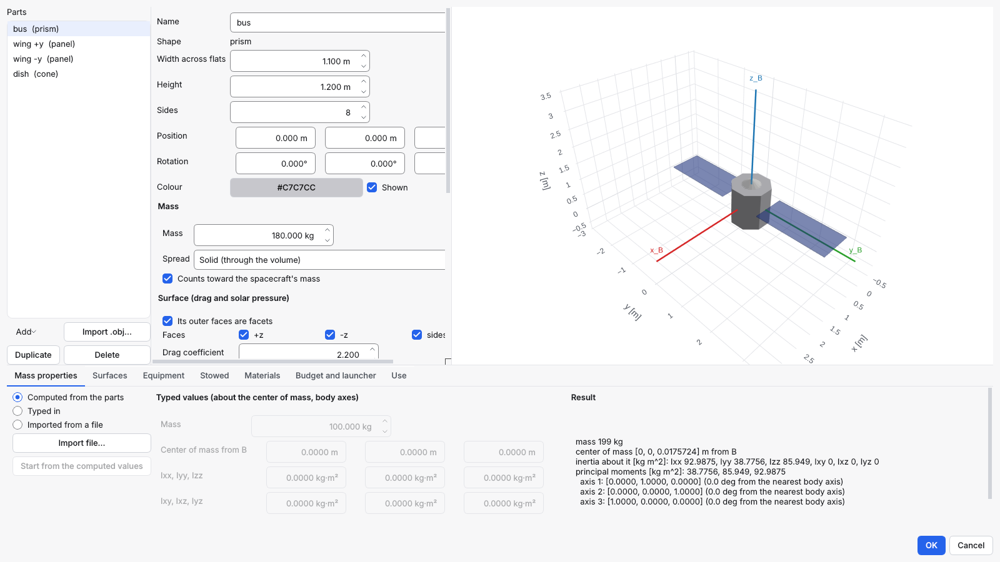

# Build a 3D model of your spacecraft

A spacecraft's 3D model gives it its mass, center of mass and moments of
inertia, the flat plates (facets) drag and sunlight push on, and its look
in Vizard. You build it from simple shapes, import it from a CAD or
modelling tool as an `.obj` file, or mix both. Template 28, "Octagonal
bus from a 3D model", is a worked example.



## Contents

- [Open the editor](#open-the-editor)
- [Build from shapes](#build-from-shapes)
- [Import an .obj file](#import-an-obj-file)
- [Mass, center of mass and inertia](#mass-center-of-mass-and-inertia)
- [Surfaces: drag and solar pressure](#surfaces-drag-and-solar-pressure)
- [What the model changes](#what-the-model-changes)
- [From the command line](#from-the-command-line)

## Open the editor

Click **3D Model...** at the top of the Scenario area (or `Ctrl+K`, "3d model");
with several spacecraft, pick the one to model. The editor opens in a
window of its own: move it, minimise it or put it on another screen, and
keep working in the main window while it is open. Each spacecraft has one
editor; asking for it again brings it to the front. **OK** stores the
model and applies it to the spacecraft as it is then (a rename or another
edit made meanwhile in the main window is kept), and **Undo** takes it
back. **Cancel**, or closing the window, asks first when you changed
something; so do **File › New**, **Open** and closing SpaceMissionStudio
while an editor holds changes.
On a spacecraft's **3D model** page (scenario tree > **Spacecraft** > its name > **3D model**):
**Build a 3D model...** (**Open 3D model editor...** once it has one). On the left is the list
of parts, in the middle the selected part's settings, on the right the
model in 3D: drag to turn it, scroll to zoom. The red, green and blue
lines are the body axes x, y and z at point B; the black diamond is the
center of mass.

## Build from shapes

**Add** gives:

| Shape | Sizes |
|---|---|
| Box | length x, y, z |
| Prism | width across flats and height; **Sides** 8 makes an octagon, 6 a hexagon |
| Cylinder | diameter, height |
| Cone | base diameter, height (base at -z, tip at +z) |
| Sphere | diameter |
| Panel | width (x), length (y), thickness (z): a solar panel or a radiator |

For each part set:

- its **Position** (its centre, from B) and **Rotation**: roll, pitch,
  yaw, applied yaw first;
- its **Mass**, and whether it is spread through the volume (**Solid**)
  or over the surface (**Shell**: a panel, a dish);
- whether it **counts toward the spacecraft's mass**. Untick it for a
  part drawn for a flexible solar array: that mass belongs to the array's
  own settings.

**Duplicate** copies the selected part, for example a second panel;
change its position. Untick **Shown** to hide a part from the view and
Vizard; it keeps its mass and facets.

## Import an .obj file

**Import .obj...** reads a Wavefront `.obj`. Every object or group in the
file becomes a part, with the file's colours. `.obj` files store neither
a unit nor which way is up, so the import asks:

- **Units**: metres, millimetres, centimetres or inches.
- **Up axis**: Z up as the body frame, or Y up (most modelling tools).

**Copy the file into the scenario's folder** keeps the scenario and its
model together; it needs the scenario saved first. Each imported part
starts with a mass of 0: give each its mass. You can move, turn, scale,
hide or delete imported parts and add shapes next to them; the
triangles themselves stay as imported.

A **Solid** mass needs a closed surface. An open one, such as a single
sheet, only works as a **Shell**, and the editor says so.

To build the model from a concurrent-engineering model made in IDM-CIC,
use **Import IDM-CIC model...** instead: see
[Import a spacecraft from IDM-CIC](idm-cic.md).

## Mass, center of mass and inertia

The **Mass properties** tab has three sources:

- **Computed from the parts**: the parts' masses, with their sizes and
  places, give the total mass, the center of mass and the inertia about
  it.
- **Typed in**: type the mass, center of mass (from B) and the inertia
  about the center of mass. **Start from the computed values** fills the
  boxes with what the parts give.
- **Imported from a file**: **Import file...** reads a JSON or CSV file,
  for instance a mass report from a CAD tool turned into this format (the
  scenario keeps the file's path and SHA-256: a later change of the file
  is a pre-run warning, `import.source_changed`):

  ```
  quantity,value
  mass_kg,152.4
  com_x_m,0.012
  com_y_m,-0.004
  com_z_m,0.31
  Ixx,18.2
  Iyy,21.5
  Izz,14.9
  Ixy,-0.3
  Ixz,0.1
  Iyz,0.2
  inertia_about,center_of_mass
  products_of_inertia,tensor
  ```

  Units are kg, m and kg m^2, in body axes. `inertia_about` is
  `center_of_mass`, or `origin` for values about B (moved to the center
  of mass for you). `products_of_inertia` says how the off-diagonal
  values are signed: `tensor` (Ixy = -∫xy dm) or `integral`
  (+∫xy dm, as some CAD tools report them). The JSON form has the same
  keys; the full format is in the ICD (`compliance/docs/ICD.md`, 5.3.11).

**Result** shows the mass, the center of mass, the inertia and the
principal moments with their axes.

## Surfaces: drag and solar pressure

Each part's outer faces become facets, with the part's drag and
reflection coefficients. Untick a face that touches another part (the
face of a box mounted on the bus) so it does not count as exposed.
Curved shapes give one facet per segment, sharing the true area. An
imported mesh gives one facet per flat plane. The **Surfaces** tab shows
the number of facets and the area seen from each axis. Parts do not
shade each other in the simulation.

## What the model changes

On **OK**, the model's values go into the spacecraft, and a message
names what was written:

- **dry mass**: the model's mass, plus any flexible solar arrays';
- the **center of mass**;
- the **inertia**, including any products of inertia;
- the **surface facets**, in full-attitude scenarios.

The **Use** tab says what the next run takes from them in this scenario:
in an orbit-only run only the dry mass (for drag and solar pressure); in a
full-attitude run the mass properties drive the attitude dynamics and the
facets the drag and solar pressure forces and torques. After a run, an
edit to the model marks the results as out of date, as any edit does.

While the model provides them, those fields are shown but locked. The
**Use** tab switches each off, and **Export .obj...** saves the model.
**Show this model in Vizard** replaces Vizard's default model, unless the
**Vizard model** page names a file of its own.

The center of mass matters: facets, thrusters and sensors are placed from
B, so a center of mass away from B gives drag, sunlight and thrust a
torque. If the model and the spacecraft's values drift apart (after an
edit in the file, say), the 3D model page and the Scenario Editor's
warnings say so; **Apply the model** on the **3D model** page puts them
back in line, and so does **OK** in the editor.

Elsewhere in the app:

- The **Problems** panel lists a model that cannot be built or
  whose values are out of date; double-click it to open that
  spacecraft's model editor.
- **Scenario > Overview** shows a "3D model, N parts" badge for each spacecraft with a
  model, and the center of mass offset; click the badge to open the
  model editor.

## From the command line

`spacemissionstudio model scenario.json` reports each model;
`--apply` writes its values into the file; `--export-obj` saves it. See
[Use the command line](command-line.md#3d-models).

## Equipment, stowed configuration, materials and the analyses

The model can also carry the spacecraft's mounted equipment (with
boresights, fields of view and exclusion angles), a stowed configuration,
materials and maturity categories, and a launcher envelope. With them the
tool checks the design and analyses a run: see
[Analyses built on the 3D model](model-analyses.md).

In the 3D model editor:

- **Equipment** lists what is mounted on the model. **Add** puts an item
  of the model's own on it (a camera, a nozzle, solar cells, a radiator,
  a unit with a mass): give it a part to move with, a position and a
  boresight in that part's frame, a field of view, the Sun, Earth and
  Moon exclusion angles, a plume half-angle for a nozzle, a mass, a
  thrust, a maturity and a subsystem. The spacecraft's sensors,
  actuators and RF antenna are listed too: **Mount on the model** gives
  one a place, and a position or boresight left unticked comes from its
  own definition (a thruster's position and direction, a sun sensor's
  normal). The device itself is still edited in its own form.
- The view draws each field of view as a translucent cone along its
  boresight and each plume as an amber cone behind its nozzle; the item
  selected in the Equipment tab is drawn stronger.
- **Stowed** gives the selected part its pose folded for launch (tick
  "moves for launch", then its position and rotation) and switches the
  view between the deployed and stowed configurations. Equipment on a
  part moves with it.
- Renaming a part renames it wherever it is named (mounts, stowed poses,
  face properties); a part that carries equipment cannot be deleted until
  the equipment is moved.

- The part form also gives each part a **material** (the library's
  sourced materials, or the model's own), a **maturity** category and a
  **subsystem** for the mass budget, and, under **Per face**, a material
  and reflection coefficients for one face in place of the part's (blank
  keeps the part's).
- **Materials** holds the model's own materials, with their values and
  where they come from. Renaming one renames it in the parts and faces
  that use it; one in use cannot be deleted.
- **Budget and launcher** sets the mass budget (the margin policy, a
  system margin in place of the policy's, the mass limit and its source)
  and the launcher envelope the stowed configuration is checked against:
  a cylinder, a box or a profile of heights and radii, its separation
  plane and axis, and its mass and centre-of-mass limits with their
  source.

The analyses of a run are chosen in the spacecraft editor's **3D model**
page.

---

**Next:** [Attitude and hardware](attitude-and-hardware.md) ·
[How-to guides](README.md)
