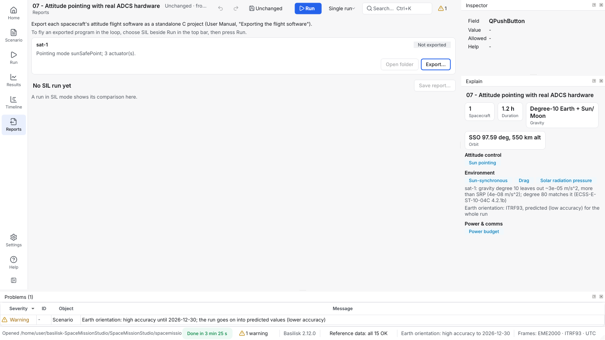

# Export the flight software, or test your own in the loop

How to turn a spacecraft's attitude flight software into a standalone C
project, and how to fly the simulation with a flight-software program of
your own (software in the loop, SIL).

## Export the flight software

You need a spacecraft with an FSW mode ([Attitude and
hardware](attitude-and-hardware.md)) and a C compiler with CMake to build
the result.

1. On the **Flight Software** page (**Tools > Flight Software**, or under
   **Analyses** in the scenario tree), find the spacecraft's card and press
   **Export...**. Choose an empty folder.
2. Build and test it:

   ```sh
   cmake -S <folder> -B <folder>/build
   cmake --build <folder>/build
   ctest --test-dir <folder>/build
   ```



The folder holds Basilisk 2.12.0's C modules (unchanged), the
configuration generated from your scenario, a scheduler, a host program,
unit tests and a replay of a recorded run, an `ICD.md` listing every
message, and a `TRACEABILITY.md` from GUI field to C source line.

The card then says whether the export still matches the scenario:

| Badge | Meaning |
|---|---|
| Up to date | The export matches the scenario's flight-software settings |
| Stale | A setting changed since; the card names which |
| Changed on disk | A file in the folder was changed |
| Folder missing | The folder is gone |

Not exported: comms pointing (refused, with the reason), and the station
keeping, phasing, formation control and data-handling logic, which run in
Python inside the tool.

## Run flight software in the loop

1. Export and build (above). The program is `<folder>/build/fsw_host`.
   For flight software of your own, build `fsw_adapter_host` from the
   export's `adapter/` folder; its `ADAPTER_GUIDE.md` explains how.
2. Set the mode beside **Run** to **SIL** and press **Run** (it asks
   which spacecraft when more than one can). The dialog finds `fsw_host`, or you
   choose another program. It shows the program's SHA-256. Tick that you
   trust it (it runs with your rights) and press **Run SIL**.
3. The run goes as usual. At the end, the Flight Software page compares
   every command the program sent with what the simulation's own modules
   computed: the largest residual, round-trip times, and plots over time.
   **Save report...** writes it as JSON and CSV.

On Linux, the exported `fsw_host` reproduces the normal run bit for bit
for the templates tested (06, 12 and 13).

## From the command line

```sh
spacemissionstudio export-fsw scenario.json --spacecraft sat-1 --out fsw_out
spacemissionstudio fsw-status scenario.json
spacemissionstudio sil scenario.json --spacecraft sat-1 --binary fsw_out/build/fsw_host \
    --report sil.json --max-error 1e-9
```

With `--max-error`, `sil` exits with status 2 when any residual is larger
or a command was never written: a check you can use in CI.

## Limits

One rate group (the dynamics step); the mission sequence and Monte Carlo
are not run in SIL; payloads are in the host's byte order. The link is a
Unix-domain socket on Linux and macOS, and TCP on 127.0.0.1 on Windows.

**More detail:** User Manual section 6,
[Exporting the flight software](../../USER_MANUAL.md#exporting-the-flight-software) and
[Running the flight software in the loop](../../USER_MANUAL.md#running-the-flight-software-in-the-loop).

---

**Next:** [Attitude and hardware](attitude-and-hardware.md) ·
[Use the command line](command-line.md)
