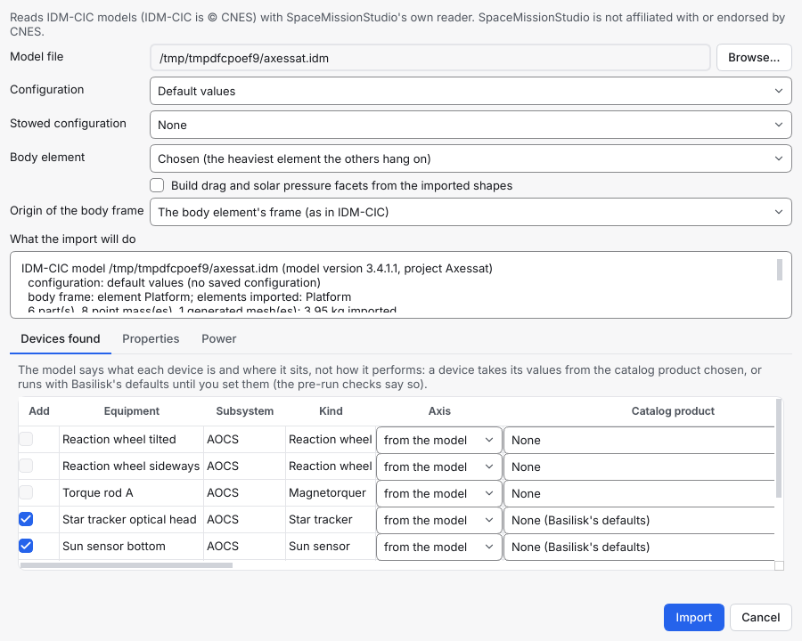

# Import a spacecraft from IDM-CIC

How to build a spacecraft's [3D model](3d-model.md), with its mass,
centre of mass and inertia, from a concurrent-engineering model made in
IDM-CIC, and how to bring later versions of that model in without losing
your own changes.

> SpaceMissionStudio reads IDM-CIC models (IDM-CIC is © CNES) with its
> own reader, written from the format's published description. It does
> not use, include or download any CNES software, and it is not
> affiliated with or endorsed by CNES. It only reads `.idm` files: it
> never writes them.

## What is imported

An IDM-CIC model (`.idm`) holds a system made of **elements** (a bus, a
payload module, an adapter), each with equipment placed in coordinate
systems, saved **configurations** (launch, operations...) and, for each
piece of equipment, its shapes and mass. The import builds the
spacecraft's 3D model from one configuration:

| In the IDM-CIC model | In the 3D model |
|---|---|
| A shape of an equipment (box, cylinder, cone, sphere, revolution solids and surfaces, extruded triangles and quadrangles, a tank, Boolean unions and differences) | A part, placed in the body frame, with the shape's mass (total, or per square or cubic metre times the area or volume) |
| An equipment whose mass is typed in rather than computed from its shapes | A point mass at its centre of gravity (the shapes come as massless parts, to see them) |
| A tank and its filling in the configuration | The tank wall as a part, and its propellant (filling x capacity) as a hidden solid part inside it |
| The articulations (hinges, slides) and optional equipment of the configuration | The parts where that configuration puts them; optional equipment only when the configuration enables it |
| A second configuration, for example the launch one | The stowed poses of the parts that are elsewhere in it, used by the launcher check |
| Mass margins and maturity levels | Listed in the import summary, not applied: the model gets nominal masses |

The **body frame** is the frame of one element, which you choose; by
default the heaviest element that the others hang on. The elements
mounted on it, directly or through others, come with it; an element that
is not mounted on it (a ground jig, an "orbit" element that only shows
the spacecraft) is left out, and the summary says why.

Not imported: power modes and duty cycles, thrusters and their
performance, thermal data, scenarios (trajectories and attitudes), the
pictures and documents attached to the model, and surface coefficients
(the file has none: facets stay off unless you ask for them, with the
default coefficients). Shapes on layers that IDM-CIC hides by default and
that carry no mass (fields of view, keep-out zones) are left out.

## Import a model

In the 3D model editor (**Scenario › 3D Model...**), choose
**Import IDM-CIC model...**, pick the `.idm` file, and choose:

- **Configuration**: the one to import, or **Default values** (each
  articulation, filling and optional equipment at its default);
- **Stowed configuration** (optional): a second configuration whose poses
  become the stowed configuration;
- **Body element**: the element whose frame is the body frame;
- whether to build drag and solar pressure facets from the imported
  boxes, cylinders, cones and spheres.



The dialog shows what the import will do before you apply it: the
elements imported and left out, the number of parts and point masses,
the mass, and every approximation. The scenario must be saved as your
own file first (not a built-in template, whose folder is not yours to
write to): the shapes that are not one of the model's own primitives are
written as meshes to `models/<spacecraft>_idm.obj` beside the scenario
file. If you started from a template, use **File › Save As** in the main
window (the editor can stay open) and import again.

From the command line:

```console
$ spacemissionstudio idm-info demosat.idm
$ spacemissionstudio idm-import demosat.idm scenario.json --spacecraft sat-1 \
      --configuration OPS --stowed-configuration LCH
```

`idm-info` lists the elements, configurations and approximations
without writing anything; `idm-import` writes the model, saves the
scenario through the change history and prints the same summary as the
dialog. Both accept `--body-element`; `idm-import` also `--apply-facets`
and `--out`.

## What is approximated

Every approximation is listed in the summary, by reason, with the parts
it concerns:

- Boolean operations: a union adds a body and a difference removes one,
  which is exact when united bodies do not overlap and removed bodies
  lie inside the rest. Other operations (intersections, section planes)
  put the shape's mass at a point.
- STEP and Collada models, pipes, labels and paths have no geometry here:
  their mass becomes a point mass at the shape's origin.
- Lines and arcs (wires) are points; with no mass they are left out.
- Curved shapes are drawn as triangle meshes whose circles keep their
  true area, so cylinders and cones have their exact volume; spheres and
  tori are within about 0.3 %.
- A shape's rounded edges and stretch factor are not modelled.
- A typed-in inertia matrix is reported, not applied (its reference point
  and axes are not stated in the file).

The conventions the reader uses (rotation order, shape origins) are in
the [design note](../developer/idm-cic-integration.md). They were fixed
against example models; if a part sits somewhere you do not expect,
please report it with the shape type.

## Import a newer version

Import the newer file the same way, into the same spacecraft. Each
imported part and point mass remembers the identifier (the `fullId`) of
the object it came from, so the import matches them even if you renamed
them:

- a value the file set last time and you have not changed is updated;
- a value you changed since is kept, and the summary lists it as
  **kept as edited**;
- new objects are added;
- an object the file no longer has is **kept, not deleted**: the summary
  lists it, and **Scenario › Overview** warns about it
  (`import.source_item_gone`) until you remove it or keep it as your own;
- values you added yourself (materials, maturity, face properties) are
  never touched.

## Where the values came from

The scenario records the import: the file's path and SHA-256, the model
version, the configurations and body element used, and each imported
value under the object's identifier. **Scenario › Overview** warns when
the file has changed since (`import.source_changed`) or is no longer
there (`import.source_missing`), and each run's provenance lists it.

---

**Next:** [3D model](3d-model.md) ·
[How-to guides](README.md)
