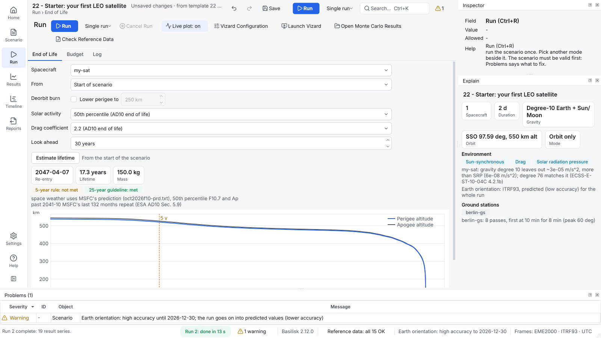
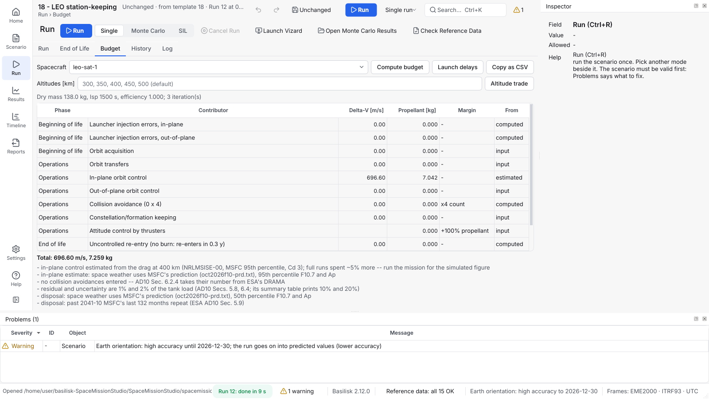

# Know when it comes down, and how much propellant it needs

How to estimate a satellite's orbital lifetime, plan a deorbit burn, and
make a delta-V and propellant budget.

Both use the scenario's atmosphere and real space weather: the observed
record, then NASA MSFC's prediction.

## Orbital lifetime

1. Open the **End of Life** tab and pick the spacecraft.
2. Press **Estimate lifetime**. You get the re-entry date and whether two
   rules are met:
   - the **5-year rule** (ESA's Zero Debris approach, the FCC);
   - the **25-year guideline** (IADC).
3. Choose **End of last run** to start from where a run ended, with the
   propellant it left.
4. Tick **Lower perigee to** to plan a deorbit burn with the orbit
   thruster. If the propellant is short, it says how low the perigee gets.



It takes seconds and agrees with full simulations to about 2 %. The
**Drag coefficient** defaults to 2.2 (ESA AD10's end-of-life value).

```console
$ spacemissionstudio lifetime spacemissionstudio/scenarios/templates/22_starter_first_leo_satellite.json
My-sat: re-entry 2047-04-07, 17.26 years from 2030-01-01
  5-year rule: not met
  25-year guideline: met
```

To compare altitudes, [`examples/altitude_lifetime_sweep.py`](../../examples/altitude_lifetime_sweep.py)
prints a table (400 km: 2.65 years, 550 km: 17.26 years).

## Propellant budget

1. Fill in the spacecraft page's **Budget (AD10)** tab: mission
   duration, dry-mass margin, tank capacity, specific impulse, injection
   errors, and the delta-V of each manoeuvre class (orbit acquisition,
   orbit control, formation keeping, collision avoidance, disposal).
2. Run the mission, ideally for its whole length. For an ESA AD10 budget,
   set **Solar activity** (on the **Environment** page) to
   *Conservative: MSFC 95th percentile* and the drag coefficient to 3.0.
3. On the **Budget** tab, press **Compute budget**. It lists each
   contributor per mission phase with its margin, the total, and notes on
   anything that departs from the guideline. **Copy as CSV** puts the
   table on the clipboard.

Without a run, a LEO station keeper's orbit control is estimated from the
drag on its orbit.



Two trades, as AD10 asks:

| Button | Answers | Takes |
|---|---|---|
| **Launch delays** | What if the launch is 1 to 5 years late (a different part of the solar cycle)? | A minute or two |
| **Altitude trade** | Which altitude fits the tank, at the worst launch date? | About ten minutes |

From the command line:

```bash
spacemissionstudio budget scenario.json --run
spacemissionstudio budget scenario.json --launch-delays
spacemissionstudio budget scenario.json --altitudes 400,450,500
```

**More detail:** User Manual section 11,
[Common questions and problems](../../USER_MANUAL.md#11-common-questions-and-problems)
(the lifetime and budget entries).

---

**Next:** [Orbit keeping and formations](orbit-keeping-and-formations.md) ·
[Reference data](reference-data.md)
