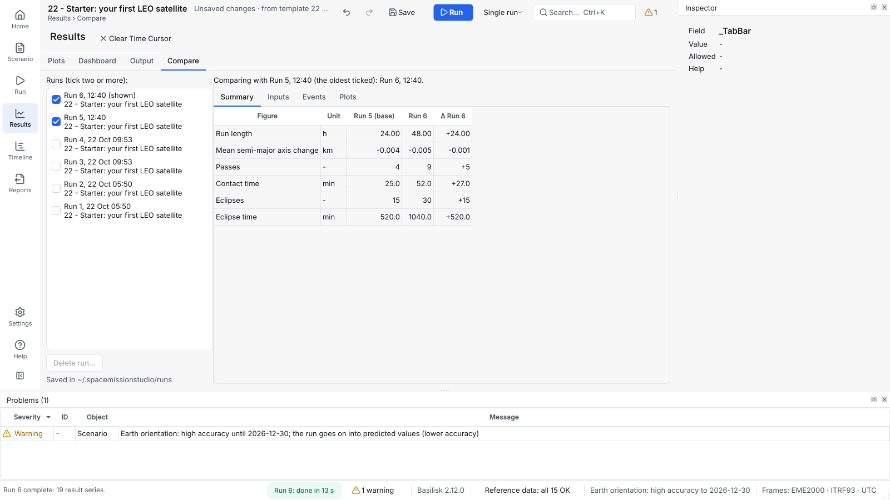
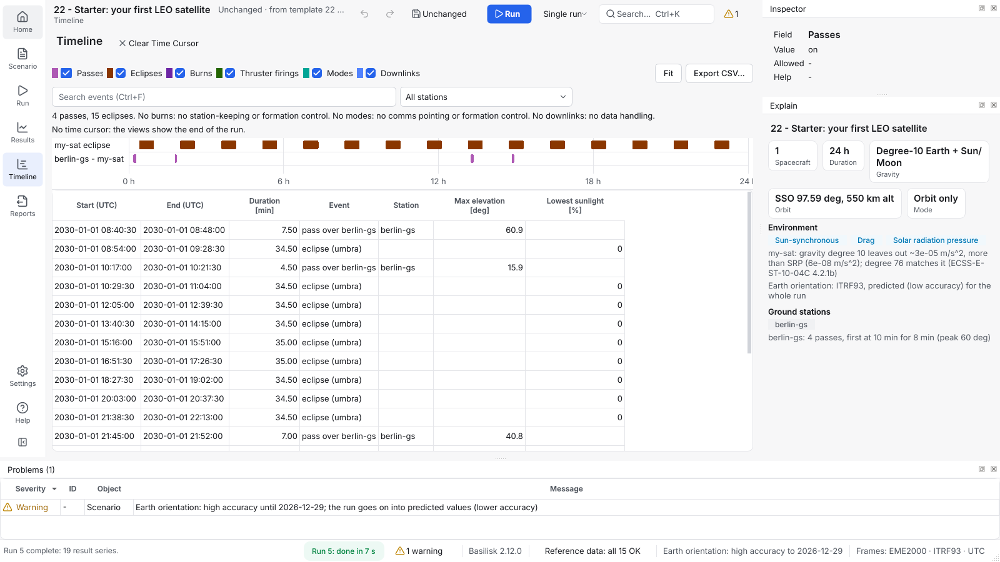

# Read the results

How to find what a run produced: plots, events, reports, the time cursor
and the exported files.

## Where things are

| Where | What it shows | Needs a run? |
|---|---|---|
| **Results > Overview** | The shown run's headline figures, and its provenance | Yes |
| **Results > Plots** | A catalog of the run's plots and a grid of up to six, with a readout | Yes |
| **Results > Dashboard** | Pointing mode, power and link at a glance (for a comms-pointing spacecraft) | Yes |
| **Results > Output** | What each `report` command in a Mission Sequence recorded | Yes |
| **Results > Monte Carlo** | The spread of a batch (shown when the scenario has Monte Carlo on or a batch is open) | A batch |
| **Timeline** | Passes, eclipses, burns and mode changes, as a timeline and a table | Yes |
| **Results > Compare** | Two or more saved runs: a summary with differences, the inputs that differ, events, plots | Two runs |
| **Run > History** | Every run kept, newest first, with its status, start and duration | Yes |
| **Run > Log** | What the app logged in this session, with every message a toast showed; a failed run opens it | No |
| **Run > End of Life** | Orbital lifetime and deorbit check | No |
| **Run > Budget** | Delta-V and propellant budget | No (better after a run) |
| **Reports > Exports** | Every export the app makes, where it is made, and when this machine last wrote one | No |
| **Reports > Flight Software** | Export the flight software, or run it in the loop | No |
| Right: **Inspector** | The field you are in: its value, accepted range and help | No |
| **Scenario > Overview** | What the scenario is set up to do, and warnings before you run | No |
| Bottom: **Problems** | What does not validate or looks implausible, by severity, field and object; double-click one to go to its field | No |
| **Reference data** dialog (status bar, or **Settings > Reference data**) | Every reference data file, its status and where it came from | No |

## Find a plot

1. On **Results > Plots**, type a few letters in **Search plots**, for example
   `altitude` or `rw_speeds`, and press Enter, or click a plot in the
   catalog. Hover an entry to see its code name (for example
   `sat-1.position_N`), which is also its CSV file name.
2. Or click one of the **Suggested** buttons: the series the scenario's
   description points at.
3. Tick more plots to see them together (up to six); **Layout** sets the
   grid. Zooming one zooms them all. The grid is kept for the scenario.
4. **X-axis** switches every plot between elapsed time, the calendar date
   and the orbit number. **Events** draws eclipses, passes and burns
   behind the lines.
5. Point at a plot: the readout under the catalog lists every shown
   value at that moment, with units.

## Compare two runs

Run again after a change, then open **Results > Compare**. The run and the one
before it are ticked; tick others to add them. The oldest ticked run is
the base:

* **Summary**: delta-V, propellant, link margin, battery, passes,
  eclipses, data and more, with a **Δ** column per run.
* **Inputs**: what you changed, old to new.
* **Events**: each kind of event counted, with its total time.
* **Plots**: one series of every ticked run, overlaid.

Every run is saved in `~/.spacemissionstudio/runs` (the newest 20), so
you can compare with a run from an earlier session. **Delete run...**
removes one. On **Results > Plots**, **Compare with** draws an earlier run's
curves dashed, and **Input differences...** lists what differs.

On the **Timeline**, the search box (**Ctrl+F**) and the station list
narrow the timeline and the table. Each value has its own column with
its unit, such as "Max elevation [deg]". Select rows and press
**Ctrl+C** to paste them into a spreadsheet; the arrow keys move the
time cursor from event to event.

## Look at one moment

Click a plot, or click on the **Timeline**, to set the **time
cursor**, or press **Alt+Right** in Results. A red line marks it
on every view; the Timeline says what is in progress then, and
**Results > Dashboard** shows the values at that moment. In Results
**Alt+Left**/**Alt+Right** move it a sample (with **Shift**, ten),
**Alt+PgUp**/**Alt+PgDown** to the previous or next event, and
**Alt+Home**/**Alt+End** to the run's start or end (the Time Cursor
commands). **Clear Time Cursor**, at the top of Results and the Timeline
(**Alt+Backspace**), removes it.

## Save what you see

| Button | Writes |
|---|---|
| Results: **Export CSV...** | Every series, in SI units, one `.csv` per series |
| Results: **Save PNG...** / **Save SVG...** | The selected plot (click a plot to select it) |
| Results: **Export all...** | Every shown plot as PNG or SVG, with its data as CSV and `provenance.json` |
| Timeline: **Export CSV...** | The events shown, in seconds and UTC, one column per measured value |
| Timeline: **Ctrl+C** | The selected rows, as tab-separated text |
| Results > Output: **Export CSV...** | Every report, in SI units |

Every export records its provenance: the software versions, the
checksum of every input, and the run's warnings, so you can tell later
exactly what produced it and what it was warned of. A run started from a
saved file with no unsaved edits also records the file's name and the
checksum of its bytes.
The Results export writes a `provenance.json` into its folder; the
Timeline and Output exports write `<file>.provenance.json` beside
the CSV; PNG and SVG files carry it inside the image.

## From the command line

`spacemissionstudio run scenario.json --out-dir out` writes the same CSV
files, `events.csv` and `provenance.json` into `out/`, and
`scenario_as_run.json`, the scenario as it was run.

**More detail:** User Manual section 7,
[Reading the results](../../USER_MANUAL.md#7-reading-the-results).

---

**Next:** [Use the command line](command-line.md) ·
[Monte Carlo](monte-carlo.md)
